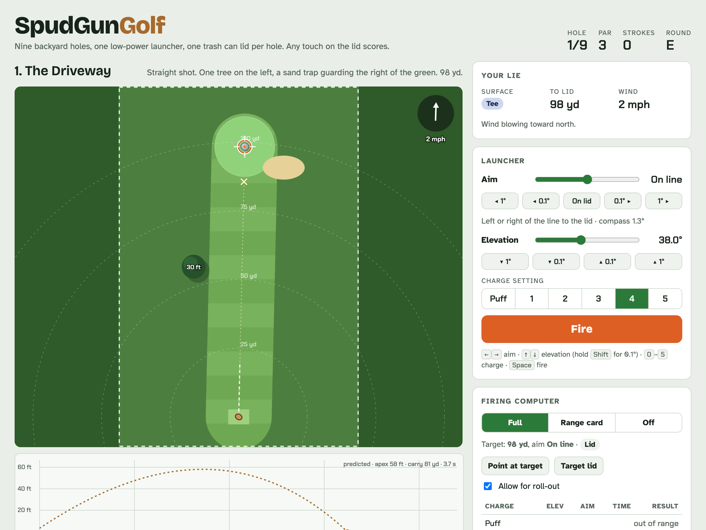
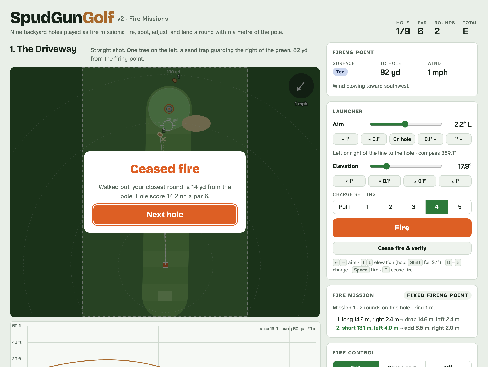

# Backyard Ballistics



*v1 Classic, the original browser game: walk to every round and finish within a metre of the pole.*

**Play in the browser:** [zacharyelston.github.io/BackyardBallistics](https://zacharyelston.github.io/BackyardBallistics/) · [v1 Classic](https://zacharyelston.github.io/BackyardBallistics/v1/) · [v2 Fire Missions](https://zacharyelston.github.io/BackyardBallistics/v2/)

| Prototype | Ruleset | How it plays |
| --- | --- | --- |
| [`prototype/spudgungolf.html`](prototype/spudgungolf.html) | v1 Classic | Walk to every round; shots to rest within 1 m of the pole; pick up for par + 3 |
| [`prototype/spudgungolf-v2.html`](prototype/spudgungolf-v2.html) | v2 Fire Missions | Range the pole with a reticle, fire from a firing point, call each round short, over or range correct (left/right is measured), let fire control bracket, cease fire and verify; rounds plus metres outside the ring. Four fixed-firing-point holes and five downrange-play holes |

v2 drives the app's requirements; v1 stays as an optional ruleset on the same engine.



v2 pars (6, 6, 6, 7, 7, 6, 6, 5, 7; par 56) come from simulating a player who uses fire control, prefers lobs, and ceases fire when a round stops improving on the best by a metre.

SpudGunGolf: a backyard trajectory game played with a low-power launcher on published courses. Each hole is a guyed furring-strip pole, and the pole is the hole: every hole is played as fire missions: range the pole with a reticle, fire, spot each round from the firing point, adjust, and score rounds fired plus metres outside the ring.

Spec: [SpudGunGolf App Spec](https://claude.ai/artifact/82Lpac7tqq2UcA4rAKZhCX)

## Layout

| Path | What it is |
| --- | --- |
| `App/` | SwiftUI iPhone app (iOS 17+): `App/` tabs and settings, `Shared/` capture and marking, `Features/` one folder per feature |
| `Packages/SpudCore/` | Platform-free core: `CoreGeo`, `SafetyKit`, `RangingKit`, with unit tests |
| `docs/ARCHITECTURE.md` | Modules, dependency rules, the safety gate and the app design |
| `docs/FLAG_KIT.md` | How to build and set up a flag |
| `docs/FIELD_TEST.md` | Field-test protocols for milestones 1 and 2 |
| `docs/COURSE_FORMAT.md` | The flat-key YAML course file a course's web server serves |
| `courses/sample-course.yaml` | Example course file |
| `prototype/` | Browser prototypes: v1 Classic and v2 Fire Missions |
| `site/`, `scripts/build-pages.sh` | GitHub Pages landing page and build; `.github/workflows/pages.yml` checks every PR and deploys `main` |
| `scripts/typecheck-ios.sh` | Typechecks everything against the iPhone SDK without signing or a simulator |
| `project.yml` | XcodeGen spec for `SpudGunGolf.xcodeproj` |

## Build

```bash
xcodegen generate
```

```bash
open SpudGunGolf.xcodeproj
```

### Run on an iPhone

Signing reads your team from `Config/Local.xcconfig`, which git ignores, so team IDs stay out of the repo.

1. In Xcode, sign in under **Settings → Apple Accounts** and create an **Apple Development** certificate (**Manage Certificates… → +**). A free Personal Team works; its installs last 7 days.
2. Write your team into `Config/Local.xcconfig`:

```bash
scripts/set-team.sh
```

3. On the iPhone, turn on **Settings → Privacy & Security → Developer Mode**, then run from Xcode, or from the command line:

```bash
xcodebuild -project SpudGunGolf.xcodeproj -scheme SpudGunGolf -destination 'platform=iOS,name=<your iPhone>' -allowProvisioningUpdates build
```

If signing fails with `errSecInternalComponent`, let Apple's tools use your key once (asks for your login keychain password):

```bash
security set-key-partition-list -S apple-tool:,apple:,codesign: -s ~/Library/Keychains/login.keychain-db
```

The camera and ARKit tools need a real device; in the Simulator the ranging screens use the simulated camera.

Run the core tests on the Mac:

```bash
cd Packages/SpudCore && swift test
```

Typecheck the app for iPhone without signing:

```bash
scripts/typecheck-ios.sh
```

## Milestone status

1. **Flag kit guide and setup flow** — built: lean check, pole height and the sighting field-test tool. Field results pending.
2. **Ranging** — built: reticle (stadia) ranging as the main method: crosshair on the pole's base, a CoreMotion-plumb line sized by the range dial, and a lock that records range, bearing, angle below level and GPS, then runs the 10 m flag check. The multi-photo AR solve (triangulation, outlier drop, height difference) stays as an optional cross-check. The spotting model (called long/short, measured left/right, bracketing) is in RangingKit. Device tuning pending.
3. Course file and validator
4. Fire control in Swift
5. Calibration shots
6. Missions and scorecard
7. Sight mode
8. Course server and registry

## Safety line

Low-power launchers only, inanimate targets on your own property, solutions capped at 100 yd and 45 m/s. Every limit lives in `SafetyKit` and nowhere else; see [ARCHITECTURE.md](docs/ARCHITECTURE.md#the-safety-gate). The app measures; it never covers building, fuelling or tuning a launcher.
