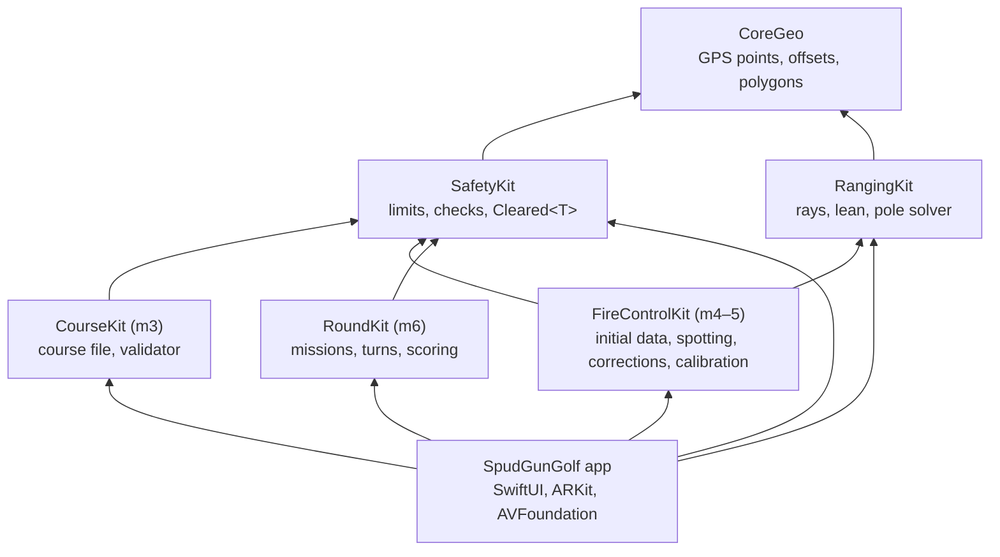
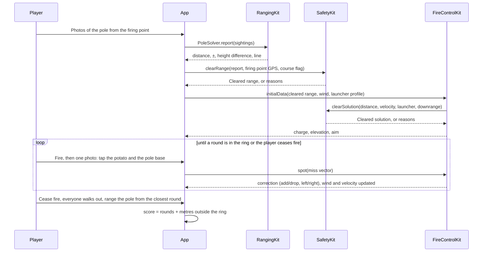

# Architecture and app design

SpudGunGolf is a thin SwiftUI/ARKit shell around a platform-free core. Everything that decides a number (ranges, solutions, limits, scores) lives in `Packages/SpudCore` and is tested on a Mac; the app only captures input, shows results and stores logs.

## Modules

Modules marked with a milestone don't exist yet; they slot in at the place shown.

| Module | Owns | Depends on | Tested by |
| --- | --- | --- | --- |
| CoreGeo | `GeoPoint`, east/north offsets, bearings, `GeoPolygon` | nothing | `swift test` |
| SafetyKit | Every safety limit, the checks, `Cleared<T>`, `DownrangeLog`, launcher conformance, `safety-limits.json` | CoreGeo | `swift test`, including a check that the browser prototype uses the same numbers |
| RangingKit | Camera intrinsics and rays, size ranging, lean, pole height, multi-photo `PoleSolver` | CoreGeo | `swift test` on synthetic scenes |
| CourseKit (m3) | Course file format, loading, validator (calls `Safety.checkFan`) | SafetyKit | planned |
| FireControlKit (m4–5) | Trajectory and roll-out model, initial data, spotting a round from the firing point, round-by-round corrections, calibration fitting | SafetyKit, RangingKit | planned |
| RoundKit (m6) | Fire missions per hole, turns, cease fire and verify, the downrange-play switch, scoring (rounds + metres outside the ring) | SafetyKit | planned |

### Dependency rules

1. Nothing in SpudCore imports UIKit, SwiftUI, ARKit or AVFoundation.
2. A module may only use modules below it in the graph. CoreGeo depends on nothing.
3. Safety numbers live only in `SafetyKit/SafetyLimits.swift` and its bundled `safety-limits.json`. Nothing else restates them; tests pin both and the prototype.
4. Accuracy thresholds (lean under 0.5°, photo agreement within 3%) stay with the module that measures them. They are not safety rules.
5. Camera hardware stays behind a seam. Only `ARKitRangingSource` touches ARKit and Core Location; `RangingSession` and the views talk to the `RangingCaptureSource` protocol. `SimulatedRangingSource` renders a pole from known poses (a phone held in portrait, ARKit's camera conventions), so the ranging flow runs in the Simulator and with the Tools toggle on a phone. New capture paths, such as spotting rounds in milestone 4, follow the same pattern.

## Services

Three pieces, each running on its own:

| Service | Where it runs | What it does |
| --- | --- | --- |
| iPhone app | Each player's phone | Ranging, firing computer, scoring; works offline once a course is loaded |
| Course server | Any plain static web server on the course's local Wi-Fi | Serves one file, `course.yaml`, with flat dotted keys ([COURSE_FORMAT.md](COURSE_FORMAT.md)). No logic, no accounts |
| Course registry | Internet | Lists courses, where they are and their file address, so players can find one before they arrive |

The app never needs internet during play: it joins the course Wi-Fi at the first firing point, fetches `http://spudgungolf.local/course.yaml`, and keeps it. Rounds stay on the players' phones. CourseKit (m3) owns parsing and validating the file; the course tool and registry are milestone 8.

## The safety gate

`Cleared<T>` can only be created inside SafetyKit. Any API that hands something to the player takes or returns a `Cleared` value, so the compiler won't let a caller skip the checks.

| Gate | Check | Blocks when |
| --- | --- | --- |
| `Safety.clearRange` | Ranged hole vs. published flag | No course flag, or more than 10 m off |
| `Safety.clearSolution` | Launcher conformance, distance, muzzle velocity, downrange confirmation | Launcher not conforming, past 100 yd, any setting over 45 m/s, or the player hasn't confirmed the fan for this hole |
| `Safety.checkLauncher` | The Launcher standard's conformance steps and this round's inspection | Unsupported launcher type, a missing step, no inspection this round, or a failed inspection item |
| `Safety.pressureInhibit` | Live pressure against the launcher's calibrated setpoint (drives the inhibit relay) | Over the setpoint, or no setpoint. Inhibit only; it never starts a shot |
| `Safety.checkCalibration` | A charge setting's fitted velocity | Over 45 m/s |
| `Safety.checkFan` | Course publishing | A firing point's 105 yd, ±30° fan leaves the boundary, or there is no boundary |

Each check returns readable reasons, so the app can explain a refusal instead of failing silently.

## App design

Three tabs, one per job:

| Tab | For | Now | Later |
| --- | --- | --- | --- |
| Play | Playing a round as fire missions | The mission loop, with ranging live | Course loading (m3), fire control (m4), missions and scoring (m6) |
| Launcher | Your launcher's profile and the limits | Fixed safety limits | Calibration shots and per-setting velocities (m5), sight mode (m7) |
| Tools | Setting up flags and testing | Lean check, pole height, ranging, sighting test, logs | Course authoring and publishing (m3, m8) |

### One fire mission, end to end

### App folder layout

| Folder | What goes there |
| --- | --- |
| `App/Sources/App` | Entry point, tabs, settings and units |
| `App/Sources/Shared` | Camera capture, the tip/base marker with loupe, `JSONStore` |
| `App/Sources/Features/<Feature>` | One folder per feature: its views, its session object, its log |

Features talk to SpudCore, not to each other. Shared UI that two features need moves to `Shared`.

### Persistence

Each log is a `JSONStore<Item>` file in Documents (`fieldlog.json`, `ranginglog.json`). Ranging records keep every photo's pose and marks so field data can be re-solved on a Mac when the solver changes. Courses and launcher profiles will follow the same pattern.

## Checking work

| Check | Command | Covers |
| --- | --- | --- |
| Core tests | `cd Packages/SpudCore && swift test` | All math and safety rules |
| iOS typecheck | `scripts/typecheck-ios.sh` | App and packages against the iPhone SDK, no signing or simulator needed |
| Device | Xcode, signed build | Camera, ARKit, GPS: the field tests in `FIELD_TEST.md` |
