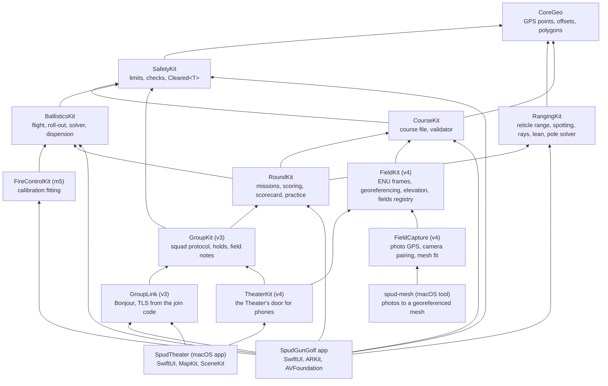
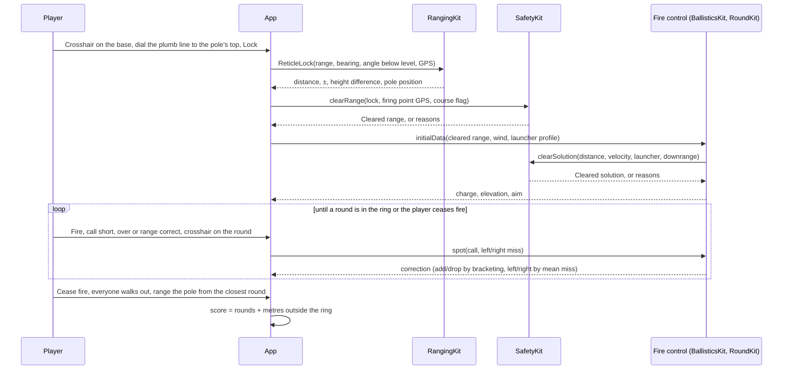

# Architecture and app design

SpudGunGolf is a thin SwiftUI/ARKit shell around a platform-free core. Everything that decides a number (ranges, solutions, limits, scores) lives in `Packages/SpudCore` and is tested on a Mac; the app only captures input, shows results and stores logs.

## Modules

FireControlKit (m5) doesn't exist yet; it slots in at the place shown. Modules marked (v3) and (v4) are for Squadz and Theater.

| Module | Owns | Depends on | Tested by |
| --- | --- | --- | --- |
| CoreGeo | `GeoPoint`, east/north offsets, bearings, `GeoPolygon` | nothing | `swift test` |
| SafetyKit | Every safety limit, the checks, `Cleared<T>`, `DownrangeLog`, launcher conformance, `safety-limits.json` | CoreGeo | `swift test`, including a check that the browser prototype uses the same numbers |
| RangingKit | `ReticleRange` and `ReticleLock` (the main ranging method), the spotting model (`Spot`, `RangeCall`, `FireControl` bracketing and left/right), camera intrinsics and rays, lean, pole height, the multi-photo `PoleSolver` cross-check | CoreGeo | `swift test` on synthetic scenes and the spec's reticle table |
| CourseKit | The course file parser (`CourseFile`), `Course`/`Hole`/`Layup`/`Flag`/`Hazard`, `CourseValidator` (calls `Safety.checkFan` and the 100 yd limit on every leg, firing point to layups to flag; a course whose only errors are fan or range errors is practice only; flag kit rules in `CourseRules`), `CourseWriter` | CoreGeo, SafetyKit | `swift test` on the sample course, malformed files and fan or boundary violations |
| BallisticsKit | Point-mass flight with drag and wind shear, roll-out per surface, the low/lob `Solver` with roll allowance, `Charge` (uncalibrated until m5, capped by SafetyKit), `Dispersion` and `SeededGenerator` | SafetyKit | `swift test`, including parity with the browser prototype's own numbers |
| RoundKit | `HolePlay` (one hole as fire missions: begin, record spots or lost rounds, cease fire, resume, advance downrange, finish), `Mission` (a lock and its `FireControl`, aim point), `HoleRules` scoring, `Scorecard`, and `PracticeRange` (simulated locks, rounds and spots on a course's geometry) | CoreGeo, RangingKit, BallisticsKit, CourseKit | `swift test`, including 40 simulated practice holes that must converge |
| GroupKit (v3 Squadz, [GROUP_PLAY.md](GROUP_PLAY.md)) | The squad protocol (`GroupMessage`, length-prefixed JSON via `GroupWire`), `SquadHost` (the commander's iPad: joins, locks gated by `Safety.clearRange` on its own course, Fired, spots, cease fire and verify, amending by replay, and the squad's own field holds: walking out, check fire, members in the fan, silent phones), `GroupGate` (holds only add to SafetyKit's verdict), and `LoopbackNetwork` | CoreGeo, SafetyKit, RangingKit, CourseKit, RoundKit | `swift test`: a squad's practice round over the loopback, and safety properties (nothing that clears or fires crosses the wire, a message fuzz can't unlock) |
| GroupLink (v3) | GroupKit over the local network with Network.framework: `GroupHost` (the iPad's listener, restarted on the same port after sleep), `GroupClient` (the phone's link, which reconnects and rejoins as the same member), `GroupBrowser`, Bonjour `_spudgolf._tcp`, TLS with a pre-shared key from the join code, an 8 s connect timeout | GroupKit | `swift test` over real local connections, including the Theater's door |
| FieldKit (v4, [THEATER_MODE.md](THEATER_MODE.md)) | The field in 3D: ENU frames, `Similarity3` georeferencing of a reconstruction to GPS, `FieldMeshInfo`, `ElevationGrid` and the USGS 3DEP requests and parsing (the Theater app does the networking), the 3D scene geometry (`SceneAxes`, terrain, fans), `FieldStore` and the fields registry (`register`, kept versions, `forget`) | CoreGeo, CourseKit | `swift test` |
| TheaterKit (v4) | `TheaterHost`: the Theater's door for phones. Contributors join with the Theater's code and send fields (registered), notes and files (saved under the field's folder, checked by SHA-256) | GroupKit, FieldKit, CourseKit, CoreGeo | `swift test` |
| FieldCapture (v4, [MESHING.md](MESHING.md)) | Photos to a georeferenced field mesh, minus RealityKit: EXIF GPS, pairing reconstructed cameras with photos, the fit to the course frame | FieldKit, CourseKit, CoreGeo | `swift test` |
| `spud-mesh` (tool) | Runs RealityKit's photogrammetry on a Mac and writes the mesh and its georeference for the Theater. macOS only; an iOS build gets a stub | FieldCapture, FieldKit, CourseKit, CoreGeo | By hand, on a Mac ([MESHING.md](MESHING.md)) |
| `spud-docs` (tool) | Prints the facts the How to play pages quote, from the real modules (`scripts/build-howto.sh`) | CoreGeo, SafetyKit, RangingKit, CourseKit, RoundKit, GroupKit | `scripts/build-howto.sh --check` |
| FireControlKit (m5) | Calibration fitting: per-setting velocities from calibration shots | BallisticsKit | planned |

### Dependency rules

1. Nothing in SpudCore imports UIKit, SwiftUI, ARKit or AVFoundation.
2. A module may only use modules below it in the graph. CoreGeo depends on nothing.
3. Safety numbers live only in `SafetyKit/SafetyLimits.swift` and its bundled `safety-limits.json`. Nothing else restates them; tests pin both and the prototype.
4. Accuracy thresholds (lean under 0.5°, photo agreement within 3%) stay with the module that measures them. They are not safety rules.
5. Camera hardware stays behind a seam. Only `ARKitRangingSource` touches ARKit and Core Location; `RangingSession` and the views talk to the `RangingCaptureSource` protocol. `SimulatedRangingSource` renders a pole from known poses (a phone held in portrait, ARKit's camera conventions), so the ranging flow runs in the Simulator and with the Tools toggle on a phone. The seam also gives the live feed's intrinsics and aim (compass bearing, angle below level) for the reticle; the simulated source holds its crosshair on the pole's base. New capture paths follow the same pattern.
6. The reticle works in sensor pixels. The dial sets the plumb line's length in pixels of the camera's native buffer, and only the view converts that to screen points, so pinch zoom and screen size never touch the range.

### Ranging with the reticle

Ranging is a stadia reading, not a tap. The crosshair sits on the pole's base, a plumb line rises from it (kept plumb by CoreMotion gravity), and the range dial is turned roughly to the top of the pole's orange band on the live view. **Freeze** then takes a full-resolution still (`captureStill`: ARKit's `captureHighResolutionFrame`, with that frame's own intrinsics and pose) and keeps the tilt, plumb direction and bearing of that moment. The player pinch-zooms on the still (anchored on the middle of the line, so the base and top stay in view), fine-matches the line's top, and taps **Lock**. If no still comes back, **Lock on the live view** still works, at the live frame's precision.

- **Range.** `d = f·H/h`, with `f` the focal length in sensor pixels, `H` the known pole height (8, 10 or 12 ft) and `h` the line length in sensor pixels. When the phone looks down at the base, `ReticleRange` corrects for the tilt exactly (`d = H / (tanθ + tan(atan(h/f) − θ))`); at level that is the plain formula. Uncorrected, the tilt reads about 14 cm short at 10 m and nothing that matters past 30 m.
- **Error.** ±1 px at the base and at the top, in quadrature: `σ = √2·d²/(f·H)`. It is set by the image the line is matched on, and the target is every iPhone, not just Pro models:

  | Image | `f` | 8 ft pole at 10/30/60/90 m | σ at 10/30/60/90 m |
  | --- | --- | --- | --- |
  | Live video, 1920 × 1440 (every iPhone) | ≈ 1500 px | 366/122/61/41 px | 4 cm, 35 cm, 1.4 m, 3.1 m |
  | Full-resolution still at Freeze, ≈ 4032 × 3024 (every iPhone, iOS 16+) | ≈ 3000 px | 731/244/122/81 px | 2 cm, 17 cm, 70 cm, 1.6 m |

  Zooming in on a still frame usually lets people match better than a pixel, so the still's figures are cautious. The lock records the image size it was matched on.
- **Height difference.** Camera height − `d·tan(angle below level to the base)`, + uphill.
- **Pole position.** GPS + compass bearing + range (`Geo.destination`); the lock then runs SafetyKit's 10 m flag check.

Lock records range, bearing, angle below level, GPS position and accuracy (`ReticleLock`). The multi-photo `PoleSolver` stays in Tools as an optional cross-check.

### Spotting

From the firing point, left/right is measured: the crosshair angle from the pole to the round, times the range. Long/short is only called (short, over or range correct), because from eye height the ground near the pole is seen at about 1° and a measured long/short miss would swing by metres with every bump. `FireControl` brackets the range from the calls, starting with a step of max(2 m, 6% of range) and halving it each round once bracketed (after a range-correct call or a change of call; never below 0.5 m), and corrects left/right by the mean measured miss. This matches `lockRange`, `spotRound` and `finishShot` in the v2 prototype.

## Services

Three pieces, each running on its own:

| Service | Where it runs | What it does |
| --- | --- | --- |
| iPhone app | Each player's phone | Ranging, firing computer, scoring; works offline once a course is loaded |
| Course server | Any plain static web server on the course's local Wi-Fi | Serves one file, `course.yaml`, with flat dotted keys ([COURSE_FORMAT.md](COURSE_FORMAT.md)). No logic, no accounts |
| Course registry | Internet | Lists courses, where they are and their file address, so players can find one before they arrive |

The app never needs internet during play: it joins the course Wi-Fi at the first firing point, fetches `http://spudgungolf.local/course.yaml`, and keeps it. Rounds stay on the players' phones. CourseKit owns parsing and validating the file, and the app's `CourseStore` caches the last good course as JSON; the course tool and registry are milestone 8.

## The safety gate

`Cleared<T>` can only be created inside SafetyKit. Any API that hands something to the player takes or returns a `Cleared` value, so the compiler won't let a caller skip the checks.

| Gate | Check | Blocks when |
| --- | --- | --- |
| `Safety.clearRange` | Ranged hole vs. published flag | No course flag, or more than 10 m off |
| `Safety.clearSolution` | Launcher conformance, distance, muzzle velocity, downrange confirmation | Launcher not conforming, past 100 yd, any setting over 45 m/s, or the player hasn't confirmed the fan for this hole |
| `Safety.checkLauncher` | The Launcher standard's conformance steps and this round's inspection | Unsupported launcher type, a missing step, no inspection this round, or a failed inspection item |
| `Safety.pressureInhibit` | Live pressure against the launcher's calibrated setpoint (drives the inhibit relay) | Over the setpoint, or no setpoint. Inhibit only; it never starts a shot |
| `Safety.checkCalibration` | A charge setting's fitted velocity | Over 45 m/s |
| `Safety.checkFan` | Course publishing | A firing point's 105 yd, ±30° fan leaves the boundary, or there is no boundary |

Each check returns readable reasons, so the app can explain a refusal instead of failing silently.

## App design

Three tabs, one per job:

| Tab | For | Now | Later |
| --- | --- | --- | --- |
| Play | Playing a round as fire missions | Play or practice a round on the loaded course, hole by hole, with the scorecard saved at the end; v3 Squadz (Command a squad, Join squad); the Course screen; saved scorecards | Real initial data once a launcher is calibrated (m5) |
| Launcher | Your launcher's profile and the limits | Fixed safety limits | Calibration shots and per-setting velocities (m5), sight mode (m7) |
| Tools | Setting up flags and testing | Lean check, pole height, ranging, survey a course (with layup points), field notes, target capture (each can be sent to the Theater), sighting test, logs | Course publishing (m8) |

### One fire mission, end to end

### App folder layout

| Folder | What goes there |
| --- | --- |
| `App/Sources/App` | Entry point, tabs, settings and units |
| `App/Sources/Shared` | Camera capture, the capture-source seam, CoreMotion gravity (`MotionReader`), the tip/base marker with loupe, `JSONStore` |
| `App/Sources/Features/<Feature>` | One folder per feature: its views, its session object, its log |
| `App/Shared` | Views both apps use: the satellite site map |
| `App/Theater` | SpudTheater, the macOS app: watching squads, the fields list, the door for phones, the 3D view |

Features talk to SpudCore, not to each other. Shared UI that two features need moves to `Shared`.

### Persistence

Each log is a `JSONStore<Item>` file in Documents (`reticlelog.json`, `ranginglog.json`, `fieldlog.json`). Reticle records keep the whole lock (line pixels, focal length, tilt, bearing, GPS); multi-photo records keep every photo's pose and marks so field data can be re-solved on a Mac when the solver changes. Scorecards are saved to `scorecards.json` when a round ends, and the round in progress (card, current hole, downrange confirmations, practice state) to `round-in-progress.json` after every change, so a locked phone or a closed app resumes mid-hole. Launcher profiles will follow the same pattern.

## Checking work

| Check | Command | Covers |
| --- | --- | --- |
| Core tests | `cd Packages/SpudCore && swift test` | All math and safety rules |
| iOS typecheck | `scripts/typecheck-ios.sh` | App and packages against the iPhone SDK, no signing or simulator needed |
| Device | Xcode, signed build | Camera, ARKit, GPS: the field tests in `FIELD_TEST.md` |
