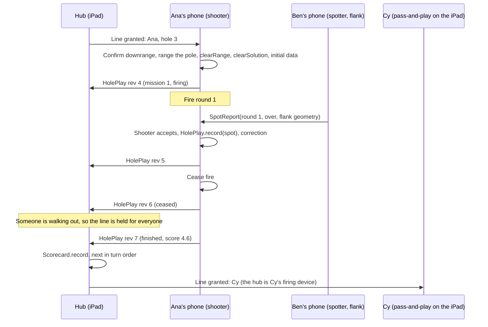

# Group play: an iPad hub with linked phones

Status: design, not built. This covers the "multi-player turns" item in milestone 6 and goes further. One iPad is the group's shared device, and each player's phone links to it as an extension of the platform. A phone shares its data with the group, and any phone can act as a spotter for someone else's round.

Read [ARCHITECTURE.md](ARCHITECTURE.md) first. This doc uses its modules, its safety gate and its dependency rules.

## Contents

1. [Goals and non-goals](#goals-and-non-goals)
2. [Roles](#roles)
3. [Transport](#transport)
4. [What is synced and who owns it](#what-is-synced-and-who-owns-it)
5. [Safety](#safety)
6. [The iPad interface](#the-ipad-interface)
7. [Phone changes](#phone-changes)
8. [Prior work: Squadz](#prior-work-squadz)
9. [Milestone plan](#milestone-plan)
10. [Open questions](#open-questions)

## Goals and non-goals

**Goals**

- Two to six players play one course together with one shared iPad. A phone is optional: a player without one plays pass-and-play on the iPad.
- The group plays fully offline. A backyard often has no internet and sometimes no Wi-Fi, so devices link directly.
- The iPad shows the course map, every player's scorecard and the turn order.
- A phone at a different position can spot another player's round.
- A phone that drops out (locked screen, walking out to verify, out of range) keeps working and catches up when it comes back.
- SafetyKit stays authoritative on the device that shows firing data. Linking devices can add holds, but it can never remove one.

**Non-goals**

- Internet play, accounts or a cloud server during a round. See [Prior work: Squadz](#prior-work-squadz) for a later, optional online layer.
- More than one launcher firing at a time. A group shares the firing line, one shooter at a time.
- Sharing launcher profiles between devices. This waits until after calibration (m5); see [Open questions](#open-questions).
- Android or a web hub.

## Roles

A device takes one or more roles in a **group round**. Roles belong to a device for the current hole and can change from hole to hole.

| Role | Device | Does | Never does |
| --- | --- | --- | --- |
| **Hub** | The iPad (one per group) | Hosts the group: roster, join code, course check, turn order, the line (who may fire now), the shared scorecard and the course map. Plays pass-and-play players who have no phone. | Show firing data for a player whose phone is their firing device, or accept a remote safety confirmation. |
| **Firing device** | The shooter's phone, or the hub for a pass-and-play player | Owns that player's `HolePlay`: ranges the pole, runs `Safety.clearRange` and `Safety.clearSolution`, shows initial data and corrections, records spots, ceases fire, verifies. | Fire without the line, or accept a lock or a confirmation it did not make itself. |
| **Spotter** | Any other phone, or the iPad as a spotting scope | Watches someone else's round and sends a spot report: a long/short call and, when it can measure one, a left/right miss. Anyone, spotter or not, can call **check fire**. | Send anything that could unlock a solution. Its message types can't carry one (see [Safety](#safety)). |

A phone is usually the firing device on its owner's turn and a spotter on everyone else's. The hub is always the hub, and it may also be a spotter (the [iPad camera as a spotting scope](#the-ipad-camera-as-a-spotting-scope)) or a pass-and-play firing device.

### A hole with three players



## Transport

The requirement is offline peer-to-peer: no internet, and preferably no Wi-Fi router either. The topology is a star, with the hub as the server and every phone as a client.

### Options

| Option | Offline, no router | Fits a hub and clients | Status and API | Notes |
| --- | --- | --- | --- | --- |
| **MultipeerConnectivity** | Yes: peer-to-peer Wi-Fi, plus infrastructure Wi-Fi when present | Poorly. It is a mesh of equal peers. Server authority, reconnects and backpressure have to be built on top, and its state callbacks are hard to reason about | Old Objective-C API, little change in years, no structured concurrency. Apple's networking engineers point new work at Network.framework | Least code to get two devices talking. An `MCSession` holds up to 8 peers. Message delivery and reconnect behaviour are opaque |
| **Network.framework with Bonjour** (`NWListener`, `NWBrowser`, `NWConnection`) | Yes. Set `includePeerToPeer = true` and it uses the same peer-to-peer Wi-Fi underneath as Multipeer, and infrastructure Wi-Fi when there is one | Well. The hub is an `NWListener` advertising a Bonjour service, and each phone browses and connects | Current, supported since iOS 12, and works with the iOS 17 deployment target | You frame your own messages (`NWProtocolFramer` or a length prefix). TLS with a pre-shared key gives an encrypted link keyed by the join code; Apple's peer-to-peer sample game does exactly this |
| **Network.framework's async API** (`NetworkConnection`, `NetworkListener`, `NetworkBrowser`) | Yes, as above | Well | iOS 26 and later. It is the same framework with a structured-concurrency surface | The best fit eventually. It needs iOS 26, and the app targets iOS 17 |
| **Wi-Fi Aware** | Yes, with no router at all | Well. Discovery and pairing come from Wi-Fi Aware, and the data goes over Network.framework | iOS 26 and later, recent hardware only, and it needs a system pairing step | Worth watching. Too new and too narrow for a group of mixed family phones today |
| SharePlay / GroupActivities, CloudKit | No: they need FaceTime or iCloud infrastructure | — | — | Ruled out by the offline requirement |
| Nearby Interaction (UWB) | Not a data transport | — | — | Could later give a phone's direction and distance from the iPad. Not needed |

Field reports put a practical ceiling of about 8 connected peers on peer-to-peer Wi-Fi, whatever the API, and Apple doesn't document the limit. Six players is well inside it.

### Recommendation: Network.framework with Bonjour, behind a seam

1. **The hub listens, and phones connect.** The hub runs an `NWListener` with `includePeerToPeer = true`, advertising `_spudgolf._tcp` with a TXT record holding the group name, protocol version and course ID. Phones run an `NWBrowser` for the same service. This works with or without the home Wi-Fi, and it needs no internet.
2. **The join code keys the link.** The hub shows a 6-character join code (and a QR code). The phone derives a TLS pre-shared key from it, so only phones that have seen the iPad's screen can connect, and nothing travels in the clear.
3. **The framing is length-prefixed JSON.** Every message is a Codable `GroupMessage` in an envelope `{protocolVersion, sender, seq, body}`. The models are small (a `HolePlay` is a few KB), so JSON is fine and easy to log.
4. **Use the `NWConnection` API now.** Move to `NetworkConnection` when the deployment target reaches iOS 26.
5. **Hide the transport behind a `GroupTransport` protocol** in `App/Sources/Shared`, the same way `RangingCaptureSource` hides the camera. Ship three implementations: `NetworkGroupTransport` (the real one), `LoopbackGroupTransport` (in memory, for `swift test` and the Simulator) and later, if wanted, a Wi-Fi Aware one. Nothing above the seam knows which radio is in use.

Info.plist needs `NSBonjourServices` = `_spudgolf._tcp`, and the `NSLocalNetworkUsageDescription` string should also mention linking to the group's iPad. The first link shows the system's local network prompt on every device; the lobby should explain it before it appears.

Multipeer is the fallback if peer-to-peer Network.framework misbehaves in the field. The protocol seam keeps that a one-file swap.

## What is synced and who owns it

### The rule: every object has exactly one owner

Conflicts are avoided rather than resolved. Each synced object has a single owning device, and only the owner changes it. Every change bumps a revision number, and the owner sends a full snapshot. Receivers keep the highest revision they have seen from the current owner and ignore everything else. With no shared writers, no clocks to sync and no merge logic, a dropped message is simply superseded by the next snapshot.

| Object | Owner | Synced how | Conflict rule |
| --- | --- | --- | --- |
| `GroupRound`: roster, players' IDs and names, course reference, practice flag | Hub | Snapshot on change | Hub only |
| Turn order and the line (`LineState`: who may fire, holds) | Hub | Snapshot on change | Hub only |
| `HolePlay` for one player on the current hole | That player's firing device | Snapshot on every change, with revision | Highest revision from the owner wins; writes from non-owners are dropped and logged |
| `Scorecard` for each player | Derived, not owned | Each device recomputes it with `Scorecard.record(HolePlay)` from finished `HolePlay`s | Nothing to resolve: same input, same card |
| `SpotReport` | Its author (a spotter) | Sent once, immutable, acknowledged | Applied only by the firing device that owns the round; see [Spots](#spots) |
| `ReticleLock` | The device that took it | Sent as data inside `HolePlay` context or a `SpotReport` | Never trusted as cleared; any consumer re-runs the gate |
| `DownrangeLog` confirmations | The firing device, by the shooter's own tap | Mirrored to the hub for display only | Never accepted from another device |
| Check fire | Whoever raised it | Broadcast through the hub | Any device can raise one; see [Safety](#safety) for lifting it |
| Course | Hub chooses it; every device validates its own copy | Course ID, version and a content hash in the hello. The hub can send `course.yaml` text to a phone that lacks it, and the phone validates it with `CourseValidator` itself | Mismatch: the phone can't join until it holds the same validated course |

### Types, built on RoundKit

A new platform-free module, **GroupKit**, sits above RoundKit in the graph. It holds the messages, ownership and revisions, turn order and the line rules. It imports nothing from UIKit or Network.framework, so the whole protocol is tested with `swift test` over the loopback transport.

```swift
// GroupKit (sketch)
public struct PlayerID: Codable, Hashable, Sendable { public let raw: UUID }
public struct DeviceID: Codable, Hashable, Sendable { public let raw: UUID }

public struct GroupPlayer: Codable, Equatable, Sendable {
    public var id: PlayerID
    public var name: String
    /// The device that fires for this player: their phone, or the hub for pass-and-play.
    public var firingDevice: DeviceID
}

public struct GroupRound: Codable, Equatable, Sendable {
    public var id: UUID
    public var courseID: String, courseVersion: Int, courseHash: String
    public var practice: Bool
    public var players: [GroupPlayer]
    public var currentHole: Int
    public var revision: Int
}

/// One player's hole, as its owner last sent it.
public struct OwnedHolePlay: Codable, Equatable, Sendable {
    public var player: PlayerID
    public var owner: DeviceID
    public var revision: Int
    public var play: HolePlay          // RoundKit's Codable HolePlay, unchanged
    public var firingPoint: Int
}

public struct SpotReport: Codable, Equatable, Sendable, Identifiable {
    public var id: UUID
    public var author: DeviceID
    public var player: PlayerID
    public var hole: Int, mission: Int, round: Int   // which FiredRound this is for
    public var call: RangeCall                       // RangingKit
    public var lateral: Double?                      // metres, + right of the pole, nil if not measured
    public var vantage: SpotterVantage?              // where the spotter stood; see "Spotting from a flank"
}

public enum GroupMessage: Codable, Sendable {
    // Hub → phones
    case round(GroupRound)
    case line(LineState)
    case course(text: String)
    // Firing device → hub (and hub → everyone, for display)
    case holePlay(OwnedHolePlay)
    case downrangeShown(player: PlayerID, hole: Int)     // display only
    // Spotter → firing device, through the hub
    case spot(SpotReport)
    case spotAck(id: UUID, applied: Bool)
    // Anyone
    case checkFire(CheckFire)
    case hello(Hello), bye
}
```

`HolePlay`, `Mission`, `FiredRound`, `Scorecard` and `Spot` travel unchanged. RoundKit needs only small additions:

- `Scorecard` gains an optional `playerID: UUID?`. It stays decodable from old files.
- `RoundStore.Active` gains `group: GroupMembership?` (round ID, hub, own player ID, last revisions seen), so a relaunched phone rejoins mid-hole.
- `HolePlay` gains an event log and a replay initializer (`HolePlay(replaying: [HoleEvent])`). Fire control is deterministic, so amending a spot means rebuilding from events rather than patching state. The snapshot stays the unit of sync, and the log is the owner's local undo.

### Spots

A round has exactly one committed spot: the one recorded into the owner's `HolePlay`. Reports are proposals.

1. A spotter sends a `SpotReport` for `(player, hole, mission, round)`. The hub relays it to the firing device and shows it on the board.
2. The firing device accepts the report only if its `HolePlay` is `.firing`, the round number is `roundsFired + 1` and the mission matches. Anything else is acknowledged with `applied: false` and kept in the log.
3. **The shooter commits.** The phone shows the reports next to its own crosshair spot: "Ben (flank): Over · Ana: Short · −0.8 m". One tap takes a report, an edit or their own call. A group setting, *auto-accept from the designated spotter*, commits the designated spotter's report directly. The firing device still applies it, never the spotter.
4. When reports disagree, the shooter decides, and the hub board shows the disagreement. There is no voting.
5. An amendment (a wrong call found after the fact) is a new commit on the firing device: it replays the hole's events with the corrected spot, bumps the revision and sends the snapshot.

### Lost links

- **A phone drops out.** It stays the owner of its `HolePlay` and keeps playing the steps that need no line: spot rounds already fired, cease fire, walk out, verify, finish. On reconnect it sends its latest snapshot, and the hub takes the higher revision. Without the hub it shows no *new* firing data in a group round (see [The line](#the-line-turns-and-holds)), and the player can leave the group to play solo.
- **The hub drops out.** Phones keep their own holes as above. When the hub returns, it rebuilds the board from their snapshots, since everything the hub owns is small and re-announced.
- **Ownership moves** only by explicit handoff, for example when a phone dies and the player continues on the iPad. The hub asks for confirmation, then becomes the owner at `revision + 1`. If the old phone returns, it sees a newer owner and goes read-only for that hole. The new firing device starts with no downrange confirmation and needs the shooter to confirm again.

## Safety

The architecture's rule still holds: `Cleared<T>` is created only inside SafetyKit, on the device that will show the result. Group play adds devices that send data, so it adds these rules.

1. **Gates run on the firing device, on its own inputs.** `Safety.clearRange` and `Safety.clearSolution` run on the device that shows the range or the firing data. A lock, spot or course received from elsewhere is input data and is gated again where it is used. `checkFlag` runs on a spotter's lock too, before the spotter's position is used.
2. **`Cleared` never crosses the wire.** `Cleared` is not `Codable`, and its initializer is file-private, so it can't be decoded. Keep it that way, and add a test that `Cleared<Int>.self` is not `Decodable` and that no `GroupMessage` case contains one.
3. **Firing data stays on the firing device.** The solution (charge setting, elevation, aim) is not part of `HolePlay`, and it is never sent. The hub shows the mission log: calls, add/drop and right/left in metres, rounds and score. It never shows another player's solution.
4. **Downrange confirmations are local.** `DownrangeLog.confirm` is called only from the shooter's own tap on the firing device. The hub can show who has confirmed, but no message can confirm on someone's behalf.
5. **A spotter can never unlock a solution.** Spotter messages are limited by type to `spot`, `spotAck`, `checkFire` and `hello`/`bye`. None carries a launcher profile, a downrange confirmation, a lock that bypasses `clearRange`, or a solution. A committed spot moves fire control's aim, and the new aim goes back through `clearSolution` (including the 100 yd distance check) before it is shown. A spot can change *where* fire control aims, never *whether* firing data is shown.
6. **The group can only add holds.** In a group round the firing device shows firing data only when **both** are true:
   - `Safety.clearSolution` returns `.success`, and
   - GroupKit's `GroupGate` has no holds for this player.

   `GroupGate` can turn allowed into blocked, never blocked into allowed. Its holds are game and turn rules, not safety numbers, so they live in GroupKit, not SafetyKit. They are shown with SafetyKit's reasons, in the same readable style.
7. **Check fire.** Any device can raise check fire with one button, at any time. It holds the line for everyone at once and clears every downrange confirmation for the current hole (this needs `DownrangeLog.revoke(hole:)`). It lifts only when the device that raised it or the hub withdraws it **and** each shooter confirms downrange again on their own phone. A dropped link never lifts it.
8. **Fail closed.** No line grant, a stale grant (hub unreachable), a protocol version mismatch or a course mismatch all mean no new firing data. Practice rounds fire nothing real, so they skip the line, but they still show the same holds so players learn the flow.
9. **No pass-through of launcher data.** Launcher profiles and per-round inspections aren't synced in group play's first version. Each firing device uses its own, as now.

Tests for these rules live in GroupKit. One is a property test: random sequences of spotter and hub messages applied to a firing device never turn a blocked verdict into an allowed one.

### The line: turns and holds

The hub owns `LineState`: whose turn it is and a list of holds. A player holds the **line** while it is their turn; only that player's firing device may show new firing data.

Holds that block everyone:

| Hold | When |
| --- | --- |
| `walkingOut(player)` | Any player's `HolePlay` is `.ceased`: someone is downrange verifying |
| `checkFire(by)` | Check fire is raised |
| `hubLost` | The firing device hasn't heard from the hub within the grant's lease (a few seconds of heartbeat) |
| `courseMismatch`, `protocolMismatch` | The device can't take part safely |

**Turn order** is game logic in GroupKit. Hole 1 follows roster order. On later holes, the lowest score on the previous hole goes first (the honour), and ties keep the previous order. The hub can reorder before a hole starts. Each player plays the whole hole on their turn (every mission, cease fire, verify), and then the line passes on. On downrange holes, a player's next mission waits for their turn again, so the course clears between missions.

## The iPad interface

The hub is the same app, launched on an iPad. `TARGETED_DEVICE_FAMILY` becomes `"1,2"`, and the Play tab gets a **Group** screen built for regular size classes. Phones keep today's layouts.

### Layout: a three-column split

`NavigationSplitView` in landscape, with **holes and players** in the sidebar, the **course map** in the content column, and the **scorecard or mission detail** on the right:

```
┌──────────────┬───────────────────────────────────┬────────────────────────┐
│ Hole 3  par 6│            COURSE MAP             │ SCORECARD    1 2 3 4 … │
│ ● Ana  ▶ line│    ⊙ flag   ring 1.5 m             │ Ana   5.2 4.6 ·        │
│ ○ Ben   spot │      ╲    · · ticks per round     │ Ben   6.0 5.1 ·        │
│ ○ Cy    next │       ╲  fan ±30°                  │ Cy    7.3 6.8 ·        │
│              │        ▲ firing point 1            │────────────────────────│
│ Holds        │                                   │ ANA · MISSION 1        │
│  none        │  [walking out] banner when ceased │ 1 Over   −1.2  drop 3  │
│              │                                   │ 2 Short  +0.4  add 1.5 │
│ [CHECK FIRE] │                                   │ 3 RC     +0.1          │
│ Join: K7Q-2MX│                                   │ spots: Ben ✓ Ana ✓     │
└──────────────┴───────────────────────────────────┴────────────────────────┘
```

- **The sidebar** shows the current hole, the turn queue (who holds the line, who's spotting, who's next), any holds, the big **Check fire** button, and the join code with linked devices and their link health.
- **The map** is a top-down drawing of the hole from the course file: boundary, hazards, firing points, flag and ring, and the ±30° safety fan from the active firing point. Each mission's aim points are drawn too. Real rounds have a measured left/right and only a *called* long/short, so they are drawn as ticks across the line at the measured lateral, not as dots, and the verified closest round is drawn as a dot. Practice rounds have true rest positions and are drawn as dots. One colour per player.
- **The right column** switches between the scorecard grid (every player, every hole, total and to-par, built from the derived `Scorecard`s) and the selected player's mission log with each round's spot reports. It never shows a solution.
- **Pass-and-play.** Selecting a player whose firing device is the hub opens today's `HoleMissionView`, full screen, as that player's turn. Everything there behaves exactly as on a phone, including the confirmations.
- In portrait or Split View, the map collapses into a tab beside the scorecard.

### The iPad camera as a spotting scope

An iPad on a tripod at the flank makes a steady spotting scope with a big screen. It reuses `CrosshairSpotView` and the reticle code with a few changes:

- **Intrinsics come from the device.** RangingKit already works in sensor pixels from ARKit's per-frame intrinsics (dependency rule 6), so an iPad camera needs no new math. Field-check it like an iPhone, using [FIELD_TEST.md](FIELD_TEST.md)'s reticle protocol.
- **Orientation.** The capture path assumes a phone held in portrait. An iPad scope is landscape, so the plumb line, the reticle overlay and the still-frame crop have to handle landscape-left and landscape-right. That is the main app-side work.
- **Position.** Many iPads are Wi-Fi only and have **no GPS**, and an offline backyard gives no Wi-Fi location fix either. The scope finds its vantage another way: (a) range the pole from the tripod (`ReticleLock` gives range and compass bearing to a known flag, so the scope's position is the flag minus that offset), (b) tap its spot on the course map, or (c) copy a phone's fix by holding the phone next to it. Option (a) is the default, because it is relative to the flag, which is what the geometry needs.
- **Steadiness.** A tripod makes the pinch-zoomed still more useful. Freeze on the splash, zoom, and put the crosshair on the round.

### Spotting from a flank

A spotter on or near the gun–target line spots exactly as the shooter does: they call long/short by eye and measure left/right with the crosshair. A spotter out at the flank sees *range* error as left/right in their own view, which is the reason to stand there. GroupKit turns that view into the same `Spot(call:lateral:)` that the game already uses, so scoring and fire control don't change:

- **Inputs.** The shooter's line (firing point and bearing, from their `Mission`), the spotter's vantage (from their own lock on the pole, checked with `checkFlag`), the spotter's crosshair angle from the pole to the round, and the shooter's measured lateral if they have one.
- **Geometry** (pure math, in RangingKit next to `Spotting`). Intersect the spotter's ray to the round with the shooter's ray (or with the aim line, if the shooter measured no lateral). Taking the round's offset from the pole, the along-line component becomes the **call** and the across-line component becomes the **lateral**.
- **The call stays a call.** Over or short beyond a range-correct band, and range correct inside it. The band is a game rule in RoundKit (start at 0.5 m, fire control's minimum step), not a safety number. The game keeps calling long/short rather than measuring it, and the flank only makes the call more reliable.
- **Conditioning.** When the spotter's line and the shooter's line meet at less than about 20°, the intersection is unreliable, and the app takes only the spotter's eye call.

Tests run on synthetic scenes, like `PoleSolver`'s.

## Phone changes

- **Join.** Play → **Join group** browses for hubs, shows each group's name and players, and asks for the code (or scans the QR code). On joining, the phone checks the course and fetches it from the hub if needed.
- **A group bar** on the round screens shows the turn and holds ("Ben's turn · you're spotting", "Hold: Cy is walking out"), link health, and a **Check fire** button.
- **Spotter mode** opens when another player fires. It shows that shooter's line and the next round number, then opens `CrosshairSpotView` with Short / Over / Range correct, and sends the report.
- **Shooter view.** Spot reports appear next to the shooter's own spot, with one tap to take one.
- **Solo is unchanged.** Without a group, nothing above runs.

## Prior work: Squadz

[Squadz](https://github.com/zacharyelston/squadz) is an earlier project with the same shape: a group, a join code, a leader, members, and live positions on a shared map. It is a Rust (Axum) REST server with a Next.js and Leaflet web client, polling every 10 seconds over the internet.

**What carries over: the model and the lessons.**

| Squadz | Group play |
| --- | --- |
| Squad with a leader and a 6-character join code | `GroupRound` with the hub as leader; the same 6-character code, here also the TLS pre-shared key |
| Member (ID, display name, joined at, is-leader) | `GroupPlayer` plus `DeviceID` |
| `SquadSettings.require_approval` | The hub can approve each join (default on for a new group) |
| Location TTL and stale flag | Link health and the line's lease: a stale firing device loses the line |
| Session with expiry and last-seen | `GroupMembership` in `round-in-progress.json` and a heartbeat |
| `SquadMap` (members on a map) | The hub's course map, with players' positions from their last lock |

**What doesn't carry over: the code.** A Rust server and a web client can't run in an offline backyard on an iPad and phones without a server to reach, and a Swift-only codebase keeps one language and the `swift test` workflow. Squadz's request/response polling also gives way to a push of owner-held snapshots.

**Where it could come back.** A Squadz-style server fits milestone 8 (course server and registry) and optional online extras after a round: uploading finished scorecards, a leaderboard per course, or remote spectators. That layer would sit *outside* play and talk to the hub after the round, never in the firing path.

## Milestone plan

Each step is small, tested and usable on its own. The steps are numbered G1–G7 so they don't collide with the main milestones. They need milestone 6 (built) and are independent of calibration (m5): until m5, real missions stop at initial data and practice mode exercises the whole flow.

| Step | Builds | Done when |
| --- | --- | --- |
| **G1. The app on iPad** | `TARGETED_DEVICE_FAMILY "1,2"`, size-class-safe layouts for today's screens, and landscape handling in the reticle and capture path | Every current screen works on an iPad in both orientations; the reticle ranging field test passes on the iPad camera |
| **G2. GroupKit core** | Module, `GroupMessage` and envelope, ownership and revisions, `GroupRound`, turn order, `LineState` and `GroupGate`, `LoopbackGroupTransport`; `Scorecard.playerID`; `DownrangeLog.revoke` | `swift test` plays a 3-player practice round over loopback, with drops and reconnects; the safety tests pass (no `Cleared` on the wire, spotter fuzz can't unlock, holds only add) |
| **G3. Link and lobby** | `NetworkGroupTransport` (listener, browser, peer-to-peer, PSK from join code, framing), Info.plist Bonjour entry, the hub lobby (code, QR, roster, approve) and phone **Join group**; course check and transfer | An iPad and two phones link in a backyard with home Wi-Fi off; course mismatch is refused; a locked phone rejoins |
| **G4. Shared round** | Phones send `HolePlay` snapshots; the hub's derived scorecards and turn queue; the line, its holds and the group bar; check fire | A 3-player practice round runs with one shooter at a time; `walkingOut` holds everyone; check fire stops everyone and needs re-confirmation |
| **G5. Spotters** | Spotter mode, `SpotReport`, shooter accept/edit, auto-accept from the designated spotter, `HolePlay` event log and replay for amendments | A spotter's call drives fire control in practice; a late or wrong-round report is refused; an amendment replays correctly |
| **G6. Hub screens** | The three-column split (map, scorecard, mission log), the map drawing, pass-and-play on the hub, ownership handoff | A group plays a full practice course with one pass-and-play player and a phone that hands off to the iPad mid-hole |
| **G7. iPad scope and flank spotting** | Flank geometry in RangingKit (with synthetic tests), the scope's vantage from a pole lock, a tripod spotting flow | Field test: flank calls from the iPad match taped positions at least as often as calls from the firing point |

G1 can start as soon as the iPad arrives. G2 needs no device at all.

## Open questions

1. **Launcher profiles in a group.** A group often shares one launcher. Should a calibrated profile be shareable as data, with the pre-round inspection still done on each firing device? Decide after m5. Until then, nothing launcher-related is synced.
2. **Phone-less hub players and confirmations.** On the shared iPad, the downrange confirmation is a tap by whoever is holding it. Is a per-player PIN or a name re-entry worth the friction?
3. **More than one shooter at a time** on holes with separate, non-overlapping fans. The line model supports it (several grants, with a check that no two fans overlap), but the first version keeps one shooter.
4. **Range-correct band** for flank calls: 0.5 m to start; tune it from G7's field data.
5. **When to move to iOS 26 APIs** (`NetworkConnection`, and perhaps Wi-Fi Aware). The transport seam makes this a contained change.
