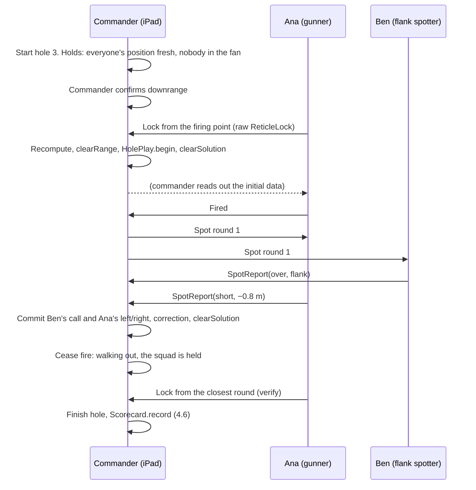

# v3 Squadz: group play

Status: G1 to G5 built (see [What's built](#whats-built)); the 3D field map on the iPad (G7) and the live render host (G8) are not. G6, a match between squads, was dropped. **v3 Squadz** is the third SpudGunGolf ruleset, after v1 Classic and v2 Fire Missions. It builds on v2: every hole is still played as v2 fire missions (range the pole, fire, spot, let fire control bracket, cease fire and verify, scored as rounds plus metres outside the ring). v3 changes who the player is: a squad of people with linked devices instead of one person with one phone. It covers the "multi-player turns" item in milestone 6 and goes beyond it. Play is like golf: a group of players works together at the head of a hole, doesn't shoot while anyone is on the field, and manages its own play on the course. There is no turn-taking with other squads. Read [ARCHITECTURE.md](ARCHITECTURE.md) first: this doc uses its modules, its safety gate and its dependency rules.

## Contents

1. [What's built](#whats-built)
2. [Two modes](#two-modes)
3. [Roles in v3 Squadz](#roles-in-v3-squadz)
4. [Transport](#transport)
5. [What is synced and who owns it](#what-is-synced-and-who-owns-it)
6. [Safety](#safety)
7. [The field map](#the-field-map)
8. [The commander's iPad](#the-commanders-ipad)
9. [The member's phone](#the-members-phone)
10. [Optional render host](#optional-render-host)
11. [Prior work: Squadz](#prior-work-squadz)
12. [Milestone plan](#milestone-plan)
13. [Open questions](#open-questions)

## What's built

The rest of this doc is the design. This section says what of it is in the code today.

- **iPad (G1).** The app runs on iPhone and iPad (`TARGETED_DEVICE_FAMILY "1,2"`). The iPad works in landscape everywhere except the camera screens: ranging and spotting measure with the camera upright, so on an iPad turned sideways they ask you to turn it upright.
- **GroupKit (G2).** `SquadHost`, `GroupGate`, the messages and `LoopbackNetwork`, tested with `swift test`: a squad's practice round over the loopback, the squad's own field holds, and the safety properties below. `Scorecard.playerID`, `DownrangeLog.revoke` and amending a spot by replay are in.
- **Commander screen (G3).** **Play → v3 Squadz → Command a squad** on the iPad. The field map is satellite imagery (MapKit) with the course boundary, flags and rings, firing points, the safety fans (the hole in play highlighted), every member's position (grey when old), used locks as lines, and orders with a place as pins. Beside it: the join code and QR code, the roster, the hole panel, locks, spot calls, orders and an inbox. The iPad stays awake on this screen.
- **Squad link (G4).** The `GroupLink` module: Network.framework with Bonjour (`_spudgolf._tcp`), TCP with TLS keyed from the 6-character join code (a pre-shared key), and GroupKit's length-prefixed JSON frames. Peer-to-peer Wi-Fi is allowed. Phones join with **Join squad**, then **Scan code** or the typed code, and report their position every few seconds while in the squad.
- **Members range and spot (G5).** Phones send raw locks (`LockReport`) and spot calls (`SpotReport`), and the gunner calls **Fired**. The iPad gates each lock against its own course flag and commits spots. A lock off the flag is refused, with the reasons sent back in a `LockReceipt`.
- **Field holds.** The iPad holds its own firing data while someone may be on the field: people walking out after cease fire, a check fire, a member inside the active fan, or a member with no position in the last 15 s (see [Safety](#safety)).
- **Orders.** The squad leader tasks one member, several or the whole squad: range the pole, spot, move to, capture, hold position, back to the firing point, or a note. Orders carry no firing data. Members answer **Seen**, **Done** or **Can't**.
- **Field notes and fields.** A member can send a field note (text, a place and a small photo) or a field they surveyed (`FieldSubmission`; the message also allows a loaded one) to the squad leader. Notes go on to anyone watching the squad (the Theater). The leader can adopt a sent-in field **between holes only**: not mid-hole, and not while people walk out. Adopting starts a fresh card on the new field, and a practice-only field puts the squad in practice. A phone can also send notes, fields and files straight to a Theater host; see [THEATER_MODE.md](THEATER_MODE.md).
- **Sleep-proof links.** If the iPad's listener fails (it slept, or the network changed), `GroupHost` starts a new one on the same port after a short pause, and again when the app comes back to the front. `GroupClient` on the phone reconnects on its own, waiting 1 s and then longer, up to 8 s between tries, and rejoins as the same member. A connection that isn't up within 8 s fails. If that happens before the phone has ever linked, or the TLS handshake fails, the phone stops and says to check the join code.
- **Protocol version 6** (`GroupProtocol.version` in GroupKit's `Messages.swift`). It goes in the Bonjour TXT record, and a device on another version is refused.

Not built yet:

- Squads play practice holes only (simulated rounds). Real rounds wait for launcher calibration (m5) anyway.
- Auto-accepting the designated spotter's report, left/right measured from a phone's spot, and flank geometry in FieldKit.
- The 3D field map on the iPad (G7) and the live render host (G8). The 3D view and `spud-mesh` exist on the Mac, for the Theater; see [THEATER_MODE.md](THEATER_MODE.md) and [MESHING.md](MESHING.md).

## Two modes

| | **Solo (v2 Fire Missions)** | **v3 Squadz** |
| --- | --- | --- |
| Who is the player | One person | **A squad**, playing its own course |
| Devices | One phone, or one iPad | Per squad: one **commander's iPad** and each member's phone. Optionally one Mac as a render host |
| Where the game runs | On that device, as it does today | On the commander's iPad, for that squad |
| Camera | The device's own camera ranges and spots | **Members' phones only.** The iPad shows the map and never uses its camera |
| What the iPad shows | Solo on a bigger screen | A **map of the field only**: every member, every observation, and the 3D field built from them, plus the squad's fire mission |
| Network | None | The squad's local group on the backyard Wi-Fi, or peer-to-peer Wi-Fi. No internet |

**Solo is the v2 Fire Missions game**, on a phone or an iPad. An iPad in Solo is just a single player: today's app on a bigger screen, using the iPad's camera for ranging and spotting. Nothing in v3 applies to it. Solo on a phone is unchanged.

**A v3 Squadz round** is one squad playing a course, hole by hole. Each hole is one fire mission sequence. **The squad is the player:** each squad has one `HolePlay` per hole and one `Scorecard`, scored exactly as Solo scores a player (rounds plus metres outside the ring). Members range, spot and observe for their squad. The commander puts it together on the map and directs the mission. The squad manages its own play: it fires only when its own field is clear.

**Non-goals:** internet play, a cloud server during play, matches or turn order between squads, and Android or web clients.

## Roles in v3 Squadz

| Role | Device | Does | Never does |
| --- | --- | --- | --- |
| **Commander** | The squad's iPad | Hosts the squad: roster, join code, the squad's `HolePlay` and `Scorecard`, the `DownrangeLog`, and the squad's holds (walking out, check fire, members in the fan, silent phones). Lifts a check fire. Sees every member on the map and builds the field from their observations. Runs `Safety.clearRange` and `Safety.clearSolution`, and is the squad's only display of the range and firing data. Tasks members ("Ben: spot from the left flank"). Commits spots. | Use its own camera in Squadz. Accept a confirmation or a cleared value from another device. |
| **Member** | Each squad member's phone | Shares its position. Ranges with the reticle and sends the raw `ReticleLock`. Spots rounds (call plus measured left/right). Sends observations for the field map. Anyone can call **check fire**. | Show the range result or firing data, or send anything that unlocks a solution. Its message types can't carry one. |
| **Gunner** | A member (often the one at the launcher) | Lays the launcher from the data the commander reads out, and calls **Fired**. | — |
| **Render host** (optional) | A Mac on the same network | Turns observations into a detailed 3D field mesh and sends it to the commander's iPad. See [Optional render host](#optional-render-host). | Take part in firing. It sees no firing data. |

### One hole



## Transport

There is one kind of link, over the local network:

- **Squad link:** each member's phone connects to its commander's iPad. This is a star. The render host, if present, and Theater observers also connect to the commander.

| Option | On home Wi-Fi | With no router | Fits host and clients | Notes |
| --- | --- | --- | --- | --- |
| **MultipeerConnectivity** | Yes | Yes (peer-to-peer Wi-Fi) | Poorly: a mesh of equal peers | Old Objective-C API, little change in years; an `MCSession` holds up to 8 peers |
| **Network.framework with Bonjour** (`NWListener`, `NWBrowser`, `NWConnection`) | Yes | Yes, with `includePeerToPeer = true` (the same radio layer as Multipeer) | Well | Current; works on iOS 12 and later, so it fits the iOS 17 target; also on macOS for the render host. Bring your own message framing. TLS with a pre-shared key keys the link from the join code |
| **Network.framework async API** (`NetworkConnection` and friends) | Yes | Yes | Well | iOS 26 and later. Adopt when the target allows |
| **Wi-Fi Aware** | — | Yes | Well | iOS 26 and later, recent hardware only, needs a system pairing step. Worth watching |
| SharePlay, CloudKit | — | No | — | Need FaceTime or iCloud infrastructure; ruled out |

**Recommendation: Network.framework with Bonjour, behind a `GroupTransport` seam.**

1. Each commander's iPad runs an `NWListener` advertising `_spudgolf._tcp`. The TXT record holds the squad, the role, the protocol version and the course ID. Phones and the render host browse for it.
2. Each squad has a 6-character join code, shown as text and a QR code. The TLS pre-shared key is derived from it, so only people who have seen that iPad can join, and nothing travels in the clear.
3. Messages are length-prefixed JSON: a Codable `GroupMessage` in `{protocolVersion, sender, seq, body}`. Mesh files from the render host go as chunked binary on their own connection.
4. Use the `NWConnection` API now, and move to `NetworkConnection` at iOS 26.
5. Hide all of this behind `GroupTransport` in `App/Sources/Shared`, like `RangingCaptureSource`. Ship `NetworkGroupTransport` and `LoopbackGroupTransport` (in memory, for `swift test` and the Simulator).

**Peer-to-peer Wi-Fi tops out around 8 peers** in field reports. A squad of up to about six with its iPad fits with no router; a bigger squad, or one with a render host and observers, should use the home Wi-Fi.

Info.plist needs `NSBonjourServices` = `_spudgolf._tcp`, and `NSLocalNetworkUsageDescription` should mention joining the squad's iPad.

**As built,** the network side is the `GroupLink` module in SpudCore, not a seam in the app: `GroupHost` (the iPad's listener), `GroupClient` (the phone's link, with reconnects) and `GroupBrowser`. The in-memory transport is GroupKit's `LoopbackNetwork`. The TXT record carries the role (`squad`, or `theater` for a Theater host), the protocol version and, for a squad, the course ID. The frames are GroupKit's `GroupWire`. Both Info.plist keys are set.

## What is synced and who owns it

Every object has one owner, and only the owner changes it. Owners send snapshots with an increasing revision number, and receivers keep the highest. Nothing needs merging.

| Object | Owner | Who receives it | Inputs from others |
| --- | --- | --- | --- |
| Squad: roster, members' devices | Commander | Members | Join requests |
| The squad's `HolePlay` (RoundKit, unchanged) | Commander | Members get a summary: phase, rounds, calls, add/drop in metres. Observers get the phase and holds | — |
| The squad's `Scorecard` (`player` = the squad's name) | Commander | Members | — |
| `DownrangeLog` (the squad is the player) | Commander, from the commander's tap | Shown to members | — |
| Firing solution | Commander only | **No one** | — |
| Member position (`GeoPoint`, accuracy, heading, time) | That member's phone | Commander (for the fan and position holds), observers through the commander | — |
| Locks, spots | Proposed by members | — | `LockReport` and `SpotReport` to the commander, who gates and commits them |
| Field observations | Their authors | Commander (and the render host) | `Observation`, see [The field map](#the-field-map) |
| Field model (sparse surface, layers) | Commander, built from observations | Render host | — |
| Field mesh (detailed) | Render host | Commander | — |
| The squad's holds (walking out, check fire, members in the fan, silent phones) | Commander | Members | Check fire from anyone |
| Course | Commander chooses it; every device validates its own copy | — | A course hash on joining |

### Types

Two new platform-free modules, both tested with `swift test`:

- **GroupKit** holds the squad protocol: messages, `SquadHost`, holds and `GroupGate`. It depends on RoundKit.
- **FieldKit** turns observations into a field model: a height-sample store, a surface built by triangulation (TIN), and the map layers. It depends on CoreGeo and RangingKit. It never imports a renderer. **As built,** FieldKit holds the field's local frames, georeferencing of photo meshes to GPS, bare-earth elevation grids and mesh records, for the Theater's 3D view. It depends on CoreGeo and CourseKit. The surface from height samples isn't built.

```swift
// GroupKit (sketch)
public struct SquadID: Codable, Hashable, Sendable { public let raw: UUID }
public struct MemberID: Codable, Hashable, Sendable { public let raw: UUID }

public struct Squad: Codable, Equatable, Sendable {
    public var id: SquadID
    public var name: String              // the "player" on the scorecard
    public var members: [Member]
}

public struct SquadRound: Codable, Equatable, Sendable {   // on the commander's iPad
    public var squad: Squad
    public var course: Course            // CourseKit, validated on this iPad
    public var practice: Bool
    public var card: Scorecard
    public var hole: HolePlay?
    public var downrange: DownrangeLog
    public var revision: Int
}

public struct MemberPosition: Codable, Equatable, Sendable {
    public var member: MemberID
    public var at: GeoPoint, accuracy: Double, heading: Double?, time: Date
}

public struct LockReport: Codable, Equatable, Sendable {
    public var id: UUID, member: MemberID
    public var purpose: Purpose          // .initial, .nextMission, .verify, .observation
    public var lock: ReticleLock         // raw: line pixels, focal length, tilt, bearing, GPS
}

public struct SpotReport: Codable, Equatable, Sendable {
    public var id: UUID, member: MemberID
    public var hole: Int, mission: Int, round: Int
    public var call: RangeCall
    public var lateral: Double?          // metres, + right; nil if not measured
    public var vantage: GeoPoint?        // for flank geometry
}
```

`HolePlay`, `Mission`, `FiredRound`, `Scorecard`, `Spot` and `ReticleLock` are reused unchanged. A squad plugs straight into RoundKit as a player. Small additions:

- `Scorecard.playerID: UUID?` (here, the squad ID). Old files still decode.
- `HolePlay(replaying:)` and an event log, so the commander can amend a spot.
- `DownrangeLog.revoke(hole:)` for check fire.
- `SquadStore` on the iPad, persisting `SquadRound` after every change.

### Locks and spots

- **Locks.** A member ranges with today's reticle screen. Lock sends the raw `ReticleLock`, and the phone says "Sent to the commander". The commander's iPad recomputes the range with RangingKit and runs `Safety.clearRange` against its own course flag. It uses the lock for its stated purpose (begin, next mission, verify), or adds it to the field map as an observation. If the check blocks, the reasons show on the iPad.
- **Spots.** When the gunner calls Fired, the commander's iPad sends "spot round N" to every member. Each member answers from `CrosshairSpotView`. The iPad accepts a report only for the round in flight. The commander commits a call and a left/right, which can come from different members; a setting can auto-accept the designated spotter's report. `HolePlay.record` on the commander's iPad is the only place a spot enters the game.
- **Flank spotting.** Members at the flank see range error as left/right. With the member's vantage (a pole lock or GPS), the shooter's line and the crosshair angle, FieldKit intersects the two rays. The along-line part becomes the **call** (over or short beyond a range-correct band, starting at 0.5 m, a RoundKit game rule), and the across-line part becomes the **lateral**. Below about a 20° crossing angle, only the member's eye call is used. The game still calls long/short; the flank just calls it better.

### Lost links

- **A member drops out.** Nothing is lost. Their marker goes stale on the map, as in Squadz, and they rejoin as the same member.
- **The commander's iPad goes away.** That squad stops. Its members show "Waiting for the commander", and the iPad resumes from `SquadStore`.
- **The render host goes away.** The map falls back to the sparse surface. Play is unaffected.

## Safety

The architecture's rule holds: `Cleared<T>` is created only in SafetyKit, on the device that shows the result. In v3 Squadz that device is the commander's iPad, for its own squad.

1. **The commander's iPad is the squad's only firing display.** `clearRange` and `clearSolution` run there, on its own validated course, launcher profile and `DownrangeLog`. Phones in v3 Squadz have no code path that shows a solution.
2. **Everything from another device is untrusted data.** That covers locks (recomputed and gated), spots (a call and metres, applied by the iPad's `HolePlay`), positions and observations. A course arriving from elsewhere is validated locally.
3. **The field map is a picture, not an input.** No surface, mesh or position from the map feeds `clearRange` or `clearSolution`. Ranges come only from cleared locks, and height differences from the lock itself. The render host's mesh is display only.
4. **`Cleared` never crosses the wire.** It isn't `Codable`, and its initializer is file-private. A test pins that `Cleared<Int>.self` is not `Decodable` and that no `GroupMessage` contains one.
5. **Firing data stays on the commander's iPad.** No message carries a charge setting, elevation or aim: not to members, observers or the render host.
6. **Confirmations happen on the commander's iPad.** The downrange confirmation for the squad is the commander's tap. No message confirms.
7. **Members can never unlock a solution.** Phone message types are limited to `position`, `lock`, `spot`, `observation`, `fired`, `checkFire`, `hello` and `bye`. A committed spot moves fire control's aim, and the new aim goes back through `clearSolution` (including the 100 yd limit) before it is shown.
8. **Holds only add.** The commander's iPad shows firing data only when `clearSolution` succeeds **and** `GroupGate` has no holds. `GroupGate` can turn allowed into blocked, never the reverse. The holds are:

   | Hold | When |
   | --- | --- |
   | `walkingOut` | The squad's `HolePlay` is `.ceased`, or the squad is walking out: people are downrange |
   | `checkFire(by)` | Anyone raised check fire |
   | `memberInFan(member)` | While a hole is live (setup or firing), a member's GPS circle lies inside the active firing point's ±30° fan |
   | `positionUnknown(member)` | While a hole is live, a member has sent no position in the last 15 s (`SquadHost.positionTimeout`) |

   The commander's iPad computes all of these itself, from its own roster, positions and hole. Between holes there are no fan or position holds. `memberInFan` and `positionUnknown` are extra protection only. GPS is accurate to a few metres, so they never replace the downrange confirmation, and a silent phone counts as unknown, not clear.
9. **Check fire** can come from any phone or the iPad, at any time. It holds the squad and revokes the current hole's downrange confirmation. Only the commander lifts it, on the iPad, and then must confirm downrange again.
10. **Fail closed.** A protocol or course mismatch keeps a device out. A lost commander stops its squad.

GroupKit includes a property test: random member, commander and render-host messages applied to a `SquadHost` never turn a blocked verdict into an allowed one.

## The field map

The commander's view is the field, built up during play from what the members observe. It works in 2D top-down and 3D orbit, with the same layers in each.

| Layer | Source | Without a render host |
| --- | --- | --- |
| **Course** | Course file: boundary, hazards, firing points, flags (with pole heights and rings), safety fans | Yes |
| **Surface** | Height samples: each cleared lock's height difference ties the pole base to the lock's position, verify locks add the closest rounds, and member GPS altitude adds samples at low weight. FieldKit triangulates them into a surface | Yes: a sparse, smooth surface, cheap to draw |
| **Members** | Live positions, heading, staleness, task ("spotting, left flank"), and each lock's line of sight drawn as a ray to the pole | Yes |
| **Mission** | Active fan, aim points, rounds as ticks across the line at the measured lateral (dots where flank geometry fixed them), the verified closest round | Yes |
| **Mesh** | A detailed textured mesh of the field from members' stills and, on LiDAR phones, ARKit scene meshes | Needs the render host |

**Observations.** An `Observation` is a cleared or raw lock, a spot with vantage, a position track, or a capture bundle: the full-resolution still that Freeze already takes, with its intrinsics and pose, plus an ARKit scene mesh on LiDAR phones. Capture bundles are large, so phones queue them and send them when idle, never during a spot. The commander can task a member to "walk the left edge" or "capture from firing point 2" to fill gaps the map shows.

**Rendering on the iPad.** RealityKit (or SceneKit) draws the course, surface, members and mission layers. A few hundred height samples and a dozen markers are light work for any iPad. The 2D view is the default; 3D is an orbit toggle.

## The commander's iPad

`TARGETED_DEVICE_FAMILY "1,2"`. On an iPad the Play tab offers **Solo** (v2 Fire Missions, a single player, with the iPad's camera) and **v3 Squadz**, which offers to command a squad. Squadz on the iPad never opens the camera.

```
┌─────────────────┬──────────────────────────────────────┬──────────────────────────┐
│ SQUAD RED  2.3↓ │            FIELD MAP (2D | 3D)       │ HOLE 3 · MISSION 1       │
│ Ana  gunner  ●  │   ⊙ flag   ring                      │ Range 62.4 ± 0.7 ✓ flag  │
│ Ben  flank L ●  │    ╲   ✦ Ben (ray to pole)           │ Initial data / correction│
│ Cy   capture ○  │     ╲ fan ±30°                       │   (this iPad only)       │
│                 │      ▲ FP1  ● Ana                    │ Round 2: spots           │
│ CARD  12.4      │   surface contours, hazards          │  Ben  Over        [✓]    │
│                 │                                      │  Ana  Short −0.8  [✓]    │
│                 │                                      │ 1 Over −1.2 drop 3.7     │
│ Holds: none     │                                      │ [Cease fire] [Lost]      │
│ [CHECK FIRE]    │                                      │ [Scorecard]              │
└─────────────────┴──────────────────────────────────────┴──────────────────────────┘
```

- **The left column** shows the squad roster, with each member's role, task and link health; the squad's card; the holds; **Check fire**; and the join code.
- **The centre** is the field map. Tapping a member tasks them, and tapping a gap asks for a capture there.
- **The right column** is today's `HoleMissionView` steps for the squad, on the big screen. It shows the range from the received lock, the downrange confirmation, initial data and corrections, spot reports with one-tap commit, and Cease fire and Verify.

## The member's phone

- **Join.** **Squadz → Join squad** browses for commanders' iPads, then takes the code or a QR scan. The phone shares its position while joined, and the system's location prompt explains why.
- **The squad bar** shows the hole, the member's task, holds and **Check fire**.
- **Range.** Today's reticle screen. Lock sends the lock to the commander.
- **Spot.** On "spot round N", `CrosshairSpotView` opens with Short / Over / Range correct and the crosshair for left/right.
- **Fired.** A button for the gunner.
- **Observe.** When tasked, Freeze-style captures that queue for upload.
- **No firing data.** The phone shows the squad's mission summary and its card.
- **Solo is unchanged.**

## Optional render host

A Mac on the same network can take the heavy work off the iPads. It is optional: Squadz plays fully without it.

**What it does**

- Builds a detailed field mesh from members' capture bundles (stills with intrinsics and pose) using RealityKit's photogrammetry on macOS. It also fuses ARKit scene meshes from LiDAR phones.
- Aligns the mesh to the course frame using the flags' known positions and pole heights as control points.
- Simplifies the mesh to levels of detail that an iPad draws smoothly, and sends USDZ tiles to each commander, refining them as more captures arrive.
- Later, if needed, re-solves FieldKit's surface at a higher density, or replays practice dispersion for the map.

**What it never does**

- Take part in firing: it receives no locks for firing, no solutions and no confirmations. Its output is display only (see [Safety](#safety), rule 3).

**In v4.** [v4 Theater Mode](THEATER_MODE.md) keeps this host as the built-in implementation of a `FieldMappingService` interface. On a course with an owner's Theater station, the course's GPU mapping back end takes this role for every squad.

**How it fits.** A small macOS target in `project.yml`, built from the same SpudCore packages (they're platform free and already build on macOS for `swift test`). It joins over the same `GroupTransport` as a `renderHost` peer with the squad's join code. Without it, each iPad draws the course, surface, members and mission layers itself, which covers everything the game needs.

## Prior work: Squadz

[Squadz](https://github.com/zacharyelston/squadz) is the earlier project v3 is named for: squads with a leader and a 6-character join code, members sharing live GPS positions, and a map of everyone with stale-position detection. It is a Rust (Axum) server with a Next.js and Leaflet client, polling over the internet.

| Squadz (earlier project) | v3 Squadz |
| --- | --- |
| Squad with a leader and a join code | Squad with a commander's iPad; the same 6-character code, also used as the TLS pre-shared key |
| Members sharing GPS locations | Members' phones sharing positions with the commander, for the fan and position holds |
| `SquadMap` with every member | The commander's field map |
| Location TTL and stale flag | Stale member markers; a phone silent for 15 s during a live hole holds the squad (`positionUnknown`) |
| `require_approval` | The commander approves each join |
| Server holds the state; clients post updates | The commander's iPad holds the squad; phones post positions, locks, spots and observations |

The code doesn't carry over: play has to run offline on iPads and phones, in Swift. The model and the server-holds-state architecture carry over directly. A Squadz-style internet server could come back after play, for milestone 8's course registry, results and leaderboards, or spectators, but never in the firing path.

## Milestone plan

These are the v3 build steps. They are numbered G1 to G8 rather than v3.1, v3.2 and so on, because a dotted number reads as a revision of the v3 ruleset (or an app release), while these are build steps toward a single v3. They are also kept separate from the app's main milestones 1 to 8. They need milestone 6, which is built. They don't need calibration (m5): until then, real missions stop at initial data, and practice mode drives everything.

| Step | Builds | Done when | Status |
| --- | --- | --- | --- |
| **G1. Solo on iPad** | `TARGETED_DEVICE_FAMILY "1,2"`, size-class-safe layouts, landscape reticle and capture, ranging without GPS from a published firing point | A solo practice round plays on an iPad as a single player | Built: iPad layouts, landscape except the camera screens, which ask to be held upright. Ranging without GPS from a published firing point isn't built |
| **G2. GroupKit over loopback** | `SquadHost` (the squad as the player, locks, spots, the squad's holds: walking out, check fire, `memberInFan`, `positionUnknown`; `GroupGate`), messages, `LoopbackGroupTransport`; `Scorecard.playerID`, `DownrangeLog.revoke`, `HolePlay` replay | `swift test` plays a squad's practice round with simulated members; the safety tests pass (no `Cleared` on the wire, the message fuzz can't unlock, holds only add, a member in the fan or a silent phone holds the squad) | Built |
| **G3. Commander screen, 2D** | The three-column iPad layout and the 2D field map (course, members and mission layers) driven by simulated members | One iPad runs a squad's practice holes with simulated members moving on the map | Built: the iPad screen with a satellite site map, driven by real phones (practice holes) |
| **G4. Squad link** | `NetworkGroupTransport`, Bonjour Info.plist, commander lobby (code, QR, approve), phone **Join squad**, live positions | Three phones join an iPad on home Wi-Fi and with the router off; members show and go stale on the map | Built: the `GroupLink` module; join by code or QR; reconnects after sleep |
| **G5. Members range and spot** | `LockReport` and `SpotReport` from phones, commit on the iPad, the gunner's Fired, auto-accept, flank geometry in FieldKit | A squad plays a practice course with real phones ranging and spotting; a lock off the flag is refused with reasons on the iPad | Built, except auto-accept and flank geometry; phones send the call only |
| **G6. Match** | — | — | Dropped. A squad manages its own field, like a group on a golf course; there is no match host, match link or turn order between squads. Its field holds moved to `SquadHost` |
| **G7. 3D field map** | FieldKit's surface from height samples, the 3D orbit view, observation capture and tasking | The map's surface matches taped heights at the flags and firing points within the locks' ± | Not built on the iPad. The Theater's Mac 3D view uses USGS ground heights, not locks |
| **G8. Render host** | The macOS target, photogrammetry and mesh fusion, alignment to the flags, LOD tiles to the iPads | A captured field renders smoothly on the iPad; switching the Mac off falls back to G7 without a hitch | Not built as a live host. `spud-mesh` builds a georeferenced mesh from photos on a Mac ([MESHING.md](MESHING.md)) |

G1 to G5 are built. G6 is dropped. G7 and G8 are next.

## Open questions

1. **Who sees the firing data.** This design shows it only on the commander's iPad, and the commander reads it out. A gunner's phone that also displayed it would become a firing device, running its own `clearSolution` with its own downrange confirmation. Is that worth adding later?
2. **The range-correct band** for flank calls starts at 0.5 m and gets tuned from G5's field data.
3. **Capture size and timing.** How many stills a decent field mesh needs, and how long uploads take on peer-to-peer Wi-Fi; G8 will measure both.
4. **iOS 26 APIs** (`NetworkConnection`, Wi-Fi Aware): adopt when the deployment target allows. The transport seam contains the change.
