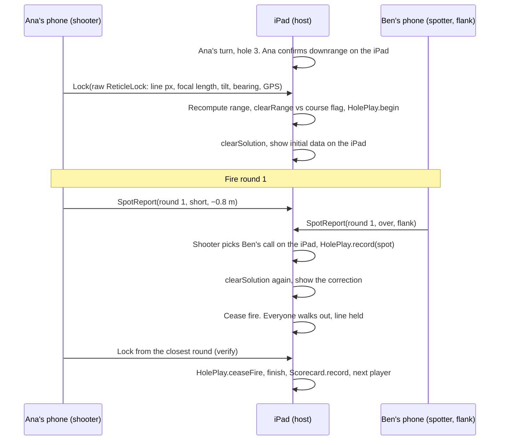

# Group play: Squadz mode, hosted on an iPad

Status: design, not built. This covers the "multi-player turns" item in milestone 6. Read [ARCHITECTURE.md](ARCHITECTURE.md) first; this doc uses its modules, its safety gate and its dependency rules.

## Contents

1. [Two modes](#two-modes)
2. [Roles in Squadz mode](#roles-in-squadz-mode)
3. [Transport](#transport)
4. [What is synced and who owns it](#what-is-synced-and-who-owns-it)
5. [Safety](#safety)
6. [The iPad interface](#the-ipad-interface)
7. [The phone in Squadz mode](#the-phone-in-squadz-mode)
8. [Prior work: Squadz](#prior-work-squadz)
9. [Milestone plan](#milestone-plan)
10. [Open questions](#open-questions)

## Two modes

| | **Solo** (mode 1) | **Squadz** (group) |
| --- | --- | --- |
| Devices | One phone | One iPad hosting the group, plus any number of phones (zero is fine) |
| Where the game runs | On the phone, as it does today | **On the iPad.** It owns every player's round, every shot and the scorecard |
| Ranging | The phone ranges and shows the result | A phone (or the iPad's camera) takes the lock; **the range and firing data are shown on the iPad** |
| Spotting | The phone spots | Any phone spots, including the shooter's own; reports go to the iPad |
| SafetyKit | Runs on the phone | Runs on the iPad, the only device that shows firing data |
| Network | None | The iPad hosts a local group on the backyard's Wi-Fi (peer-to-peer Wi-Fi when there's no router). No internet |

Solo stays exactly as built. Squadz mode needs an iPad, and the iPad **owns the shot**. A phone in Squadz mode is a remote camera, a remote control and a spotting scope for the iPad. It never computes or shows firing data.

This model keeps group play simple:

- **There is one authority.** Every rule, score and safety check runs on one device, so devices never have to resolve competing versions of a hole.
- **Safety stays where it is today.** SafetyKit runs on the one device that shows firing data, as it does in solo. Phones send measurements and calls, the iPad checks them, and nothing that unlocks a solution ever crosses the wire.
- **Everyone sees the same thing.** The group gathers around one big screen showing the map, the shot and the scorecard.

**Non-goals:** internet play or a cloud server during a round, more than one shooter at a time, a phone hosting a group, and Android or web clients.

## Roles in Squadz mode

| Role | Device | Does | Never does |
| --- | --- | --- | --- |
| **Host** | The iPad (one per group) | Runs the game: roster, join code, course, turn order, every player's `HolePlay`, `Scorecard`s, `DownrangeLog`. Runs `Safety.clearRange` and `Safety.clearSolution`. Shows range, initial data, corrections, the map and the scorecard. Ranges and spots with its own camera when wanted. | Accept a safety confirmation or a cleared value from a phone. |
| **Rangefinder** | The shooter's phone (or any phone, or the iPad camera) | Runs today's reticle screen and sends the raw `ReticleLock` to the iPad. | Show the range result or firing data. |
| **Spotter** | Any phone, the shooter's included, or the iPad camera | Sends a spot report for the round in flight: short / over / range correct, plus the measured left/right. Anyone can call **check fire**. | Send anything that can unlock a solution; its message types can't carry one. |

A player without a phone plays entirely on the iPad: ranging with the iPad camera, spotting by eye with the call buttons, or both.

### One shot, end to end



## Transport

The iPad is a server and phones are its clients: a star, not a mesh. It hosts on the backyard's Wi-Fi and falls back to peer-to-peer Wi-Fi when there is no router. There is never any internet.

| Option | On home Wi-Fi | With no router | Fits a host and clients | Notes |
| --- | --- | --- | --- | --- |
| **MultipeerConnectivity** | Yes | Yes (peer-to-peer Wi-Fi) | Poorly: a mesh of equal peers, with server authority and reconnects built on top | Old Objective-C API, little change in years; an `MCSession` holds up to 8 peers; delivery and reconnects are opaque |
| **Network.framework with Bonjour** (`NWListener`, `NWBrowser`, `NWConnection`) | Yes | Yes, with `includePeerToPeer = true` (the same radio layer Multipeer uses) | Well: the iPad is an `NWListener`, phones browse and connect | Current, iOS 12+, works with the iOS 17 target. You frame your own messages. TLS with a pre-shared key encrypts the link with a key from the join code; Apple's peer-to-peer sample game does this |
| **Network.framework async API** (`NetworkConnection`, `NetworkListener`, `NetworkBrowser`) | Yes | Yes | Well | iOS 26+. The same framework with structured concurrency. Adopt when the target allows |
| **Wi-Fi Aware** | — | Yes | Well (data still over Network.framework) | iOS 26+, recent hardware, a system pairing step. Worth watching |
| SharePlay, CloudKit | — | No | — | Need FaceTime or iCloud infrastructure; ruled out |

Field reports put a practical ceiling of about 8 peers on peer-to-peer Wi-Fi (undocumented). On a home router the limit is much higher.

### Recommendation: Network.framework with Bonjour, behind a seam

1. **The iPad listens and phones connect.** The iPad runs an `NWListener` with `includePeerToPeer = true`, advertising `_spudgolf._tcp`. Its TXT record holds the group name, protocol version and course ID. Phones run an `NWBrowser`. The same code works on the home Wi-Fi and with no router.
2. **The join code keys the link.** The iPad shows a 6-character join code and a QR code, and the phone derives the TLS pre-shared key from it. Only phones that have seen the iPad can join, and nothing travels in the clear.
3. **The framing is length-prefixed JSON.** Every message is a Codable `GroupMessage` in an envelope `{protocolVersion, sender, seq, body}`. Messages are small and easy to log.
4. **Use the `NWConnection` API now**, and move to `NetworkConnection` at iOS 26.
5. **Hide it behind a `GroupTransport` protocol** in `App/Sources/Shared`, the way `RangingCaptureSource` hides the camera. Ship `NetworkGroupTransport` and `LoopbackGroupTransport` (in memory, for `swift test` and the Simulator). Multipeer or Wi-Fi Aware would be one more implementation.

Info.plist needs `NSBonjourServices` = `_spudgolf._tcp`, and `NSLocalNetworkUsageDescription` should mention joining the group's iPad. The lobby explains the system's local network prompt before it appears.

## What is synced and who owns it

**The iPad owns everything that matters.** Phones send *inputs* (locks, spots, check fire) and receive *views* (whose turn it is, what to spot, holds, the scorecard). No synced state has two writers, so there is nothing to merge.

| Object | Owner | Phones get | Phones send |
| --- | --- | --- | --- |
| `GroupRound`: roster, course reference, practice flag | iPad | Snapshot | Join request |
| Turn order and the line (`LineState`: who's up, holds) | iPad | Snapshot | — |
| `HolePlay` per player (RoundKit, unchanged) | iPad | A read-only summary: phase, rounds fired, the calls and add/drop in metres, the round awaiting a spot | — |
| `Scorecard` per player | iPad (`Scorecard.record(HolePlay)`) | Snapshot | — |
| `DownrangeLog` | iPad, by the shooter's tap on the iPad | Who has confirmed (display) | — |
| Firing solution | iPad only | **Never sent** | — |
| Locks | Taken on a phone, *used* on the iPad | — | `LockReport` with the raw `ReticleLock` |
| Spots | Proposed by a phone, *committed* on the iPad | Whether it was applied | `SpotReport` |
| Check fire | Whoever raised it; the iPad enforces it | Snapshot of holds | `checkFire` |
| Course | iPad | `course.yaml` text if the phone lacks it | Its course hash in the hello |

Revisions still matter for display. Every iPad snapshot carries an increasing revision number, and phones keep the highest. A phone that reconnects asks for fresh snapshots, so dropped messages never need replaying.

### Types: a new GroupKit module on RoundKit

**GroupKit** is platform free and sits above RoundKit. It holds the messages, the host's game state (`SquadzHost`), turn order, the line and `GroupGate`. The whole host runs under `swift test` over the loopback transport.

```swift
// GroupKit (sketch)
public struct PlayerID: Codable, Hashable, Sendable { public let raw: UUID }
public struct DeviceID: Codable, Hashable, Sendable { public let raw: UUID }

public struct GroupPlayer: Codable, Equatable, Sendable {
    public var id: PlayerID
    public var name: String
    public var phone: DeviceID?        // nil: plays on the iPad only
}

/// The game, as the iPad holds it. Persisted to round-in-progress.json on the iPad.
public struct SquadzRound: Codable, Equatable, Sendable {
    public var id: UUID
    public var course: Course          // CourseKit, validated on the iPad
    public var practice: Bool
    public var players: [GroupPlayer]
    public var cards: [PlayerID: Scorecard]
    public var holes: [PlayerID: HolePlay]   // the current hole per player
    public var downrange: DownrangeLog
    public var line: LineState
    public var revision: Int
}

public struct LockReport: Codable, Equatable, Sendable {
    public var id: UUID
    public var from: DeviceID
    public var player: PlayerID
    public var purpose: Purpose        // .initial, .nextMission, .verify, .spotterVantage
    public var lock: ReticleLock       // RangingKit's raw record: line pixels, focal length, tilt, bearing, GPS
}

public struct SpotReport: Codable, Equatable, Sendable {
    public var id: UUID
    public var from: DeviceID
    public var player: PlayerID
    public var hole: Int, mission: Int, round: Int
    public var call: RangeCall
    public var lateral: Double?        // metres, + right; nil if not measured
    public var vantage: SpotterVantage?
}

public enum GroupMessage: Codable, Sendable {
    // iPad → phones
    case round(RoundView), line(LineState), awaitingSpot(SpotRequest), applied(id: UUID, ok: Bool, reason: String?)
    case course(text: String)
    // Phone → iPad
    case lock(LockReport), spot(SpotReport), checkFire(CheckFire), hello(Hello), bye
}
```

`HolePlay`, `Mission`, `FiredRound`, `Scorecard`, `Spot` and `ReticleLock` are reused unchanged. Small additions:

- `Scorecard.playerID: UUID?`, still decodable from old files.
- `HolePlay(replaying: [HoleEvent])` and an event log, so the iPad can amend a spot by replaying. Fire control is deterministic.
- `DownrangeLog.revoke(hole:)` for check fire.
- `SquadzStore` on the iPad next to `RoundStore`, persisting `SquadzRound` after every change. A closed app resumes mid-hole, as solo does.

### Locks

1. The shooter (or whoever is ranging) uses today's reticle screen on their phone. **Lock** sends a `LockReport` with the whole raw `ReticleLock`. The phone says "Lock sent to the iPad"; it does not show the range.
2. The iPad recomputes the range from the raw fields with RangingKit, runs `Safety.clearRange` against its own course's flag, and shows the result. If the check blocks, it shows the reasons on the iPad and the phone is told to range again.
3. A cleared lock is used for the purpose it was sent for: begin a mission, the next downrange mission, verify after cease fire, or a spotter's vantage.

The iPad camera can do the same on the iPad itself, with no phone.

### Spots

1. When a round is fired (the shooter taps **Fired** on the iPad, or on their phone), the iPad sends `awaitingSpot` for `(player, hole, mission, round)` to every phone.
2. Any phone, the shooter's included, can answer with a `SpotReport` from `CrosshairSpotView`. The iPad's own call buttons and camera work too.
3. The iPad accepts a report only if that player's `HolePlay` is `.firing` and the round number is `roundsFired + 1`. Anything else is answered `applied: false` with the reason.
4. **The shooter commits on the iPad.** The mission view lists the reports ("Ben (flank): Over · Ana: Short −0.8 m"), and one tap records one; the call and the left/right can come from different reports. A group setting, *auto-accept from the designated spotter*, commits that spotter's report as soon as it arrives. Either way, the iPad's `HolePlay.record` is the only place a spot enters the game.
5. An amendment replays the hole's events with the corrected spot.

### Lost links

- **A phone drops out.** Nothing is lost, because the game lives on the iPad. That player ranges and spots with the iPad until the phone rejoins with the same player ID (the iPad remembers the device).
- **The iPad goes away** (locked, app closed, out of range). The round stops for everyone: there's no shot without the host. Phones show "Waiting for the iPad". The iPad resumes from `SquadzStore`, and phones reconnect on their own.

## Safety

The architecture's rule holds unchanged: `Cleared<T>` is created only in SafetyKit, on the device that shows the result. In Squadz mode that device is always the iPad.

1. **The iPad is the only firing device.** `Safety.clearRange` and `Safety.clearSolution` run on the iPad, on the iPad's validated course, launcher profile and `DownrangeLog`. A phone in Squadz mode has no code path that shows a solution.
2. **Phone input is untrusted data.** A lock arrives raw and is recomputed and gated on the iPad. A spot is a call and a number in metres, and it is applied by the iPad's `HolePlay`. The course hash is checked on join, and a phone's course never replaces the iPad's.
3. **`Cleared` never crosses the wire.** It isn't `Codable` and its initializer is file-private. Keep it that way, with a test that `Cleared<Int>.self` is not `Decodable` and that no `GroupMessage` case contains one.
4. **Firing data stays on the iPad.** No message carries a charge setting, elevation or aim. Phones see the mission summary (calls, add/drop and right/left in metres, score).
5. **Confirmations happen on the iPad.** The downrange confirmation is a tap on the iPad by the shooter for their hole, with their name on the button. No message can confirm.
6. **Spotters can never unlock a solution.** Phone message types are limited to `lock`, `spot`, `checkFire`, `hello` and `bye`. A committed spot moves fire control's aim, and the new aim goes back through `clearSolution`, including the 100 yd distance check, before it is shown. A spot changes *where* fire control aims, never *whether* a solution is shown.
7. **Group holds only add.** The iPad shows firing data only when `clearSolution` succeeds **and** GroupKit's `GroupGate` has no holds. `GroupGate` turns allowed into blocked, never the reverse. Its holds are turn rules, not safety numbers, so they live in GroupKit.
8. **Check fire.** Any phone or the iPad can raise check fire at any time. It blocks all firing data and revokes the hole's downrange confirmations. It lifts only when it is withdrawn on the iPad **and** each shooter confirms downrange again there. A phone dropping its link never lifts it.
9. **Fail closed.** A protocol or course mismatch keeps a phone out. The iPad going away stops the round.

GroupKit includes a property test: random sequences of phone messages applied to a `SquadzHost` never turn a blocked verdict into an allowed one.

### The line: turns and holds

| Hold | When |
| --- | --- |
| `notYourTurn` | Firing data is shown only for the player whose turn it is |
| `walkingOut(player)` | Any player's `HolePlay` is `.ceased`: someone is downrange verifying |
| `checkFire(by)` | Check fire is raised |

**Turn order.** Hole 1 goes in roster order. On later holes, the lowest score on the previous hole goes first, and ties keep the previous order. The iPad can reorder before a hole. Each player plays their whole hole on their turn (every mission, cease fire and verify), then the turn passes. On downrange holes a player's next mission waits for their next turn, so the course clears between missions.

## The iPad interface

Same app, `TARGETED_DEVICE_FAMILY "1,2"`. On an iPad the Play tab offers **Solo** and **Host a Squadz round**. Phones offer **Solo** and **Join a Squadz round**.

### Layout

`NavigationSplitView` in landscape: **players and holds** on the left, the **course map** in the middle, and **the shot** (or the scorecard) on the right.

```
┌──────────────┬──────────────────────────────┬─────────────────────────────┐
│ Hole 3 par 6 │          COURSE MAP          │ ANA · MISSION 1             │
│ ▶ Ana  firing│   ⊙ flag  ring 1.5 m          │ Range 62.4 m ± 0.7  ✓ flag  │
│   Ben  spot  │     ╲  ticks per round        │ Initial data / correction   │
│   Cy   next  │      ╲  fan ±30°              │   (iPad only)               │
│              │       ▲ firing point 1        │ Round 2 awaiting spot       │
│ Holds: none  │                              │  Ben (flank)  Over      [✓] │
│              │                              │  Ana          Short −0.8 [✓]│
│ Phones ●●○   │                              │ 1 Over  −1.2  drop 3.7      │
│ [CHECK FIRE] │                              │ [Fired] [Lost] [Cease fire] │
│ Code K7Q-2MX │                              │ [Scorecard]                 │
└──────────────┴──────────────────────────────┴─────────────────────────────┘
```

- **The left column** shows the hole, turn queue, holds, linked phones and their link health, the **Check fire** button and the join code. The downrange confirmation appears here at the start of each player's turn, with that player's name.
- **The map** is drawn top-down from the course file: boundary, hazards, firing points, the flag and its ring, and the ±30° fan from the active firing point. It also shows each mission's aim points. Real rounds have a measured lateral but only a called long/short, so they are drawn as ticks across the line, and the verified closest round as a dot. Practice rounds have true positions and are drawn as dots. One colour per player.
- **The right column** is today's `HoleMissionView` steps, laid out for the big screen: the range from the received lock, initial data and corrections, the spot reports with one-tap commit, and the Fired, Lost, Cease fire and Verify actions. **Scorecard** swaps in the grid for all players and holes.
- In portrait or Split View the map moves to a tab.

### The iPad camera as a rangefinder and spotting scope

The iPad can range and spot by itself: for a phone-less player, or on a tripod at the flank as a steady, big-screen scope.

- **Intrinsics.** RangingKit works in sensor pixels from ARKit's per-frame intrinsics (dependency rule 6), so the math carries over. Field-check the iPad with [FIELD_TEST.md](FIELD_TEST.md)'s reticle protocol.
- **Orientation.** Capture assumes a phone in portrait. On the iPad, the plumb line, reticle overlay and still crop need landscape-left and landscape-right. That is the main app-side work.
- **Position.** Many iPads are Wi-Fi only and have **no GPS**, and an offline backyard gives no Wi-Fi fix. Ranging *for a shot* needs the firing point's position for `clearRange`, so the iPad uses (a) the firing point's published position, when the shooter stands at it, or (b) a fix from the shooter's phone. As a flank scope, its vantage comes from a lock on the pole: range and bearing to a known flag.

### Spotting from a flank

A spotter near the gun–target line spots as today: they call long/short by eye and measure left/right. A spotter out at the flank sees *range* error as left/right in their own view. The iPad turns that into the same `Spot(call:lateral:)`, so scoring and fire control are unchanged:

- **Inputs:** the shooter's line (from the `Mission`), the spotter's vantage (a pole lock, checked with `checkFlag`), the spotter's crosshair angle from the pole to the round, and the shooter's measured lateral when there is one.
- **Geometry** (pure math, in RangingKit next to `Spotting`): intersect the spotter's ray with the shooter's ray, or with the aim line. The round's offset from the pole splits into an along-line part, which becomes the **call**, and an across-line part, which becomes the **lateral**.
- **The call stays a call.** Over or short beyond a range-correct band; range correct inside it. The band is a RoundKit game rule, starting at 0.5 m.
- **Conditioning:** when the two lines meet at less than about 20°, the iPad uses only the spotter's eye call.

## The phone in Squadz mode

- **Join.** **Join a Squadz round** browses for iPads, shows each group's name and players, and asks for the code (or scans the QR code). The phone picks its player or adds one, and gets the course from the iPad if needed.
- **The group bar** shows the turn, holds, link health and **Check fire**.
- **Range.** On your turn (or when asked), today's reticle screen with the dial, Freeze and Lock. Lock sends the lock to the iPad, and the result appears there.
- **Spot.** When a round is in the air, `CrosshairSpotView` opens on every phone, with Short / Over / Range correct and the crosshair for left/right. It sends a report, and the phone shows whether the iPad applied it.
- **Watch.** A read-only mission summary and the scorecard. No firing data.
- **Solo is unchanged.** Leaving the group, or never joining, gives today's app.

## Prior work: Squadz

[Squadz](https://github.com/zacharyelston/squadz) is an earlier project with the same shape: a group, a join code, a leader, members, and live positions on a shared map. It is a Rust (Axum) REST server with a Next.js and Leaflet web client, polling over the internet. Group play takes its name and its model.

| Squadz | Squadz mode |
| --- | --- |
| Squad with a leader and a 6-character join code | `SquadzRound`, with the iPad as leader; the same 6-character code, here also the TLS pre-shared key |
| Member (ID, display name, joined at, is-leader) | `GroupPlayer` with an optional phone `DeviceID` |
| `SquadSettings.require_approval` | The iPad approves each join (default on) |
| Location TTL and stale flag | Phone link health on the iPad |
| Session with expiry and last-seen | Phone rejoin by device ID; heartbeat |
| Server holds the state; clients post updates | The iPad holds the game; phones post locks and spots |
| `SquadMap` (members on a map) | The iPad's course map, with players at their last lock |

**The code doesn't carry over.** The host has to run on an iPad in a backyard with no internet, and a Swift-only codebase keeps one language and the `swift test` workflow. The architecture does carry over: one server holding the state, and clients that post updates and get snapshots back. The iPad is that server, and push replaces polling.

**Where a Squadz server could come back:** milestone 8 (course server and registry), and online extras after a round, such as scorecard upload, course leaderboards and remote spectators. The iPad would talk to it after play, never in the firing path.

## Milestone plan

The steps are numbered G1–G7 to keep them apart from the main milestones. They need milestone 6 (built), and they don't depend on calibration (m5): until then, real missions stop at initial data and practice exercises everything.

| Step | Builds | Done when |
| --- | --- | --- |
| **G1. Solo on iPad** | `TARGETED_DEVICE_FAMILY "1,2"`, size-class-safe layouts, landscape reticle and capture, ranging without GPS (published firing point) | A solo practice round plays on the iPad in landscape; the reticle field test passes on the iPad camera |
| **G2. GroupKit host** | `SquadzRound`, `SquadzHost` (turns, locks, spots, line, `GroupGate`, check fire), messages, `LoopbackGroupTransport`; `Scorecard.playerID`, `DownrangeLog.revoke`, `HolePlay` replay | `swift test` plays a 3-player practice round with simulated phones over loopback; the safety tests pass (no `Cleared` on the wire, phone-message fuzz can't unlock, holds only add) |
| **G3. Squadz round on the iPad alone** | Host mode with pass-and-play: roster, turn order, the three-column layout, `SquadzStore` | A 3-player practice round runs on one iPad with no phones |
| **G4. Link and lobby** | `NetworkGroupTransport` (listener, browser, peer-to-peer, pre-shared key from the code, framing), Bonjour Info.plist, host lobby (code, QR, approve) and phone **Join**; course transfer | Two phones join on home Wi-Fi and with the router off; a course mismatch is refused; a locked phone rejoins as the same player |
| **G5. Phones as rangefinders** | `LockReport` from the phone's reticle screen; the iPad recomputes, gates and shows the range | A shooter's phone lock begins the mission on the iPad; a lock off the flag is refused, with reasons on the iPad |
| **G6. Phones as spotters** | `awaitingSpot`, `SpotReport`, commit on the iPad, auto-accept from the designated spotter, amendments | The shooter's and a spotter's reports both reach the iPad; a wrong-round report is refused; a full practice course plays with phones spotting |
| **G7. Flank spotting and the iPad scope** | Flank geometry in RangingKit with synthetic tests; a vantage from a pole lock; the tripod scope flow | Field test: flank calls match taped positions at least as often as calls from the firing point |

G1 can start when the iPad arrives. G2 needs no device. G3 is playable group golf before any networking.

## Open questions

1. **A phone-less player's downrange tap** happens on the shared iPad by whoever holds it. Is a per-player PIN worth the friction?
2. **Fired:** should "Fired" be tapped on the iPad only, or also from the shooter's phone? The current sketch allows both; the round only counts on the iPad.
3. **Launcher profile.** After m5 the profile and per-round inspection live on the iPad, since it shows the firing data. Should a solo phone's calibrated profile transfer to the iPad, and how is it re-checked there?
4. **The range-correct band** for flank calls: 0.5 m to start, tuned from G7's field data.
5. **iOS 26 APIs** (`NetworkConnection`, perhaps Wi-Fi Aware): when the deployment target allows; the transport seam contains the change.
