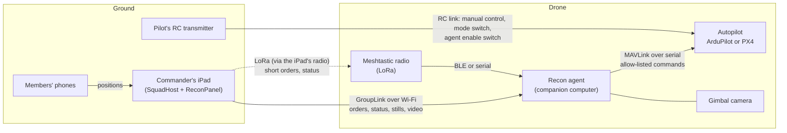

# Recon: a drone the commander can task

Status: design, not built. This doc proposes how a squad leader on the iPad (or a boat captain using
the sister project's Osprey Recon) tasks a camera drone with one order: **"fly over there, look at
that, and loiter in the area."** It covers the drone's software, the order model, the wire formats on
Wi-Fi and LoRa, the iPad's screen, a hazard analysis, the rules to check, and the order to build it in.

Read [GROUP_PLAY.md](GROUP_PLAY.md), [THEATER_MODE.md](THEATER_MODE.md),
[SQUAD_COMMS.md](SQUAD_COMMS.md) and [LORA_MESSAGES.md](LORA_MESSAGES.md) first. This doc uses their
roles, links, keys and codec. **It changes none of their safety rules**: firing data stays on the
commander's iPad and never goes over any link, holds only add, the map is display only, and the 91 m
(100 yd) limit per shot stands. The drone adds holds; it never lifts one.

**This is design guidance, not legal advice.** The rules section says what was checked and what
wasn't. Check the rules where you fly before you fly.

## Contents

1. [What it is, and what it isn't](#what-it-is-and-what-it-isnt)
2. [Architecture](#architecture)
3. [The order model](#the-order-model)
4. [From orders to MAVLink](#from-orders-to-mavlink)
5. [Wire formats](#wire-formats)
6. [The iPad and the phones](#the-ipad-and-the-phones)
7. [Safety: hazard analysis](#safety-hazard-analysis)
8. [Rules to check](#rules-to-check)
9. [Corrections to SQUAD_COMMS's LoRa numbers](#corrections-to-squad_commss-lora-numbers)
10. [Build steps](#build-steps)
11. [Open questions](#open-questions)
12. [Sources](#sources)

## What it is, and what it isn't

| | |
| --- | --- |
| **Is** | A camera and a radio that fly. It goes where the commander points, looks at what the commander points at, stays there for a while, and comes home. It shows the commander pictures and its own position |
| **Is not** | A weapon, a spotter for firing data, a target designator, a delivery drone or a tracker of strangers. It carries **no release or drop mechanism**, and **no message, code or MAVLink command it will send can release anything** |
| **Who flies it** | A human pilot with a radio transmitter, standing at the field, who can see the drone and can take over at any time. The commander tasks; the pilot is in charge of the aircraft |
| **Where** | Inside the course boundary (or, for the boat, a declared operating area), under a ceiling, in sight of the pilot |

Two airframes, one contract:

| | Squadz (golf, ski touring, SAR practice) | Osprey Recon (the boat's scout) |
| --- | --- | --- |
| Airframe | A small **multirotor**: hovers, turns on the spot, lands in a yard | A printed **fixed wing**, about 2 kg, up to 120 m: can't hover, needs room to turn |
| Camera | A gimbal camera | A gimbal, or a side-looking PTZ eye each side plus a belly fisheye |
| Commander | The squad leader's iPad | The captain's tablet |
| Home | A fixed launch point outside every firing fan | The boat, which moves |
| Typical order | Orbit the corner of the field at 40 m, watching hole 3's flag | Fly to the anchorage 8 km ahead, survey it, come back (see [Rules to check](#rules-to-check) on range) |

The rest of this doc says "commander" for both the squad leader and the captain.

## Architecture



### The pieces

| Piece | What | Runs | Owns |
| --- | --- | --- | --- |
| **Autopilot** | An off-the-shelf flight controller running **ArduPilot** (Copter or Plane) or **PX4** | On the drone | Flying: attitude, position, the geofence, the failsafes, battery monitoring. **Everything that keeps the aircraft safe without the agent lives here** |
| **Recon agent** | A small program on a companion computer (a Raspberry Pi class board) wired to the autopilot | On the drone | Joining the squad, checking each order, turning it into MAVLink, reporting status, the camera, stills and video |
| **Meshtastic radio** | A RAK4631 or similar, on the agent's serial or BLE | On the drone | The LoRa link, and relaying for the squad's mesh where that is allowed ([Rules to check](#rules-to-check)) |
| **RC transmitter** | The pilot's ordinary radio control | In the pilot's hands | Manual control, the flight mode switch, and an **agent enable** switch |
| **Recon panel** | A new panel on the commander's iPad | On the iPad | Composing orders, showing the drone, its camera footprint and its video |
| **Remote ID module** | A broadcast module or built-in Remote ID | On the drone | Broadcasting the drone's and pilot's position as the law requires |

### The agent joins the squad as an `aerial` member

The agent is a squad member with a new role, **`aerial`**, next to `member`, `observer` and
`contributor`. It enrols the way a phone does under the member credentials in
[SQUAD_COMMS.md, Part 1](SQUAD_COMMS.md#part-1-member-credentials): once, with the enrolment code,
and from then on with a credential in the companion computer's storage. The credential's role is
`aerial`, and the squad host takes the role from the credential, never from the `Hello`.

| An `aerial` member | May | May never |
| --- | --- | --- |
| Send | Its position, its status, answers to orders, stills and video (Wi-Fi only), check fire | A lock, a spot for firing, Fired, an order to anyone, anything that confirms downrange or lifts a hold |
| Receive | Recon orders from its **controlling commander**; the course (boundary, fans, flags); the active fan and holds; positions of members who allow themselves to be look-at targets | Firing data of any kind. None exists to send |

The agent depends only on the generic squad layer (`SquadKit`, proposed in SQUAD_COMMS Part 3) and a new
platform-free module, **`ReconKit`**: the order types, the agent's checks and state machine, and the
LoRa codes. `ReconKit` has no dependency on SafetyKit's firing paths, RoundKit or `GroupGate`. Like the
standalone squad app, the drone has no firing code at all.

### Links, in order of preference

| Link | Range (rough) | Carries | When |
| --- | --- | --- | --- |
| **GroupLink over Wi-Fi** | Tens to a few hundred metres to the iPad, more with a good access point | Everything: orders, status at 1–2 Hz, stills, video, route and area plans | Whenever it's up |
| **LoRa via Meshtastic** | Kilometres, line of sight from the air | Short orders and status, in the codec below. **No pictures** | When Wi-Fi is down, or always for a few safety messages |
| **A separate video link** | Hundreds of metres to kilometres | Live video to the pilot's goggles or screen | Optional. It isn't part of the squad protocol |
| **RC link** | The pilot's radio range | Manual control | Always, while flying |

The `LinkRouter` from SQUAD_COMMS picks links by priority. Recon orders are `control`; recall
(return home, hold, land) is `emergency`; status is `routine`; pictures are `bulk`.

### The agent never trusts itself with safety alone

The autopilot holds the geofence, the ceiling, the battery failsafe and the lost-link failsafe as
parameters, set before take-off. The agent checks the same things first, so it can refuse an order with
a reason the commander can read. If the agent crashes, hangs or sends nonsense, the autopilot's own
limits still hold, and the agent's heartbeat stopping is itself a failsafe trigger (see
[Lost links](#lost-links-and-their-timers)).

## The order model

### One order, three parts

"Fly over there, look at that, loiter in the area" is three separable parts. Each can be changed on
its own.

| Part | Means | Default if left out |
| --- | --- | --- |
| **Go to** | A place to fly to | The drone's current position |
| **Look at** | What the camera holds on: a place, a course flag, a squad member who shares a position, the orbit's centre, or straight down | Ahead along the track |
| **Loiter** | How to stay: an orbit (centre, radius, direction) or a hover; at an altitude; until a condition | Orbit the go-to place at the airframe's minimum radius (fixed wing), or hover there (multirotor) |

The orbit's centre and the look-at point are separate on purpose: orbit a field corner at 60 m and
watch the flag 40 m away; or circle wide of a moored boat and keep the camera on its anchor line.

### The type

```swift
// ReconKit (sketch). Platform-free, Codable, no firing data.
public struct ReconOrder: Codable, Equatable, Sendable, Identifiable {
    public var id: MessageRef            // sender index + message ID, shared by every link (SQUAD_COMMS)
    public var drone: MemberID           // the aerial member it's for
    public var task: Task
    public var altitude: Double?         // metres above the launch point; nil keeps the current one
    public var speed: Double?            // m/s ground speed in transit; nil = the airframe's default
    public var until: Until
    public var issued: Date              // commander's clock; shown, never trusted for ordering

    public enum Task: Codable, Equatable, Sendable {
        /// Go, look and loiter in one order.
        case station(goTo: GeoPoint, look: LookAt, loiter: Loiter)
        /// Change only where to go; keep the current look-at and loiter style.
        case goTo(GeoPoint)
        /// Change only what the camera holds on.
        case lookAt(LookAt)
        /// Loiter where the drone is now.
        case loiterHere(Loiter)
        case patrol(route: PlanID, laps: Int)            // a route sent beforehand over Wi-Fi
        case survey(area: PlanID)                        // a photo grid, planned on the iPad
        case search(area: PlanID, pattern: SearchPattern)
        case hold                                        // stop and stay where you are
        case resume                                      // carry on with the order a hold paused
        case returnHome
        case land(at: GeoPoint?)                         // multirotor; a fixed wing uses its landing plan
        case releaseToPilot                              // the agent stops commanding; the pilot flies
    }
}

public struct Loiter: Codable, Equatable, Sendable {
    public enum Style: Codable, Equatable, Sendable {
        case orbit(radius: Double, clockwise: Bool)      // metres
        case hover                                       // multirotor only
    }
    public var center: GeoPoint?                         // nil = the go-to place
    public var style: Style
}

public enum LookAt: Codable, Equatable, Sendable {
    case ahead                                           // no ROI: the camera looks along the track
    case place(GeoPoint, height: Double?)                // height above ground, metres; nil = ground
    case flag(hole: Int)                                 // a published course flag, from the course file
    case member(MemberID)                                // a squad member who shares a position and allows it
    case center                                          // the orbit's centre
    case down                                            // straight down (survey)
}

public struct Until: Codable, Equatable, Sendable {
    public var minutes: Int?                             // on station; nil = no time limit
    public var reservePercent: Int                       // go home when the battery reaches this; never below the airframe's floor
    // A new order always ends the current one, so it isn't a field.
}
```

**What can be a look-at target.** A place, a course flag, the orbit's centre, straight down, or a squad
member who shares a position **and** has allowed it on their phone. Never a person outside the squad.
There is no "follow that person" or "track that vehicle" order, the agent never sends MAVLink's visual
tracking commands, and the look-at list on the iPad offers only squad members who opted in. A member's
look-at position comes from their own phone's GPS, sent to the commander; the agent updates the
camera's point of interest from it at most once a second.

### Composing it on the iPad

| Gesture | Sets |
| --- | --- |
| Tap the map with the **Go** tool | The go-to place (and orbit centre) |
| Drag out from the centre | The orbit radius. The ring snaps up to the airframe's minimum and turns red where it leaves the geofence or enters an active fan |
| Tap the ring's arrow | Clockwise or anticlockwise |
| Tap with the **Look** tool | A place to look at. Tapping a flag or a member's dot picks that flag or member instead |
| Altitude slider | 10 m to the geofence ceiling |
| Until | A time on station, and a battery reserve |
| **Send** | Checks the order on the iPad, then sends it |

The iPad runs the same checks as the agent (`ReconKit` on both), so most refusals happen before
sending. The agent checks again: it is the one that knows its battery and its autopilot's limits.

### How the drone answers

Every order gets an **answer** and then **task states**. On Wi-Fi they are `AerialAnswer` and
`AerialStatus`; on LoRa they are the `ack` type and the task-state report (below).

| Answer | Means |
| --- | --- |
| **Accepted** | The order passed every check. The drone starts it now |
| **Can't**, with a reason | The order was refused, and the drone carries on with what it was doing |

| Can't reason | Code |
| --- | --- |
| Outside the geofence, or over the ceiling | 1 |
| The path or the orbit crosses an active firing fan | 2 |
| Orbit radius under the airframe's minimum | 3 |
| Not enough battery for this task and the trip home with the reserve | 4 |
| Look-at target not allowed (not a squad member, not sharing, or opted out) | 5 |
| Not from my controlling commander | 6 |
| The pilot has control | 7 |
| No GPS fix, or the position is stale | 8 |
| Unknown route or area (send the plan over Wi-Fi first) | 9 |
| This airframe can't do that (a hover on a fixed wing) | 10 |
| A hold is in force that stops this (course closed, airspace recall) | 11 |
| Unknown instruction (update the app) | 255 |

| Task state | Means |
| --- | --- |
| **En route** | Flying to the go-to place. Carries an ETA |
| **On station** | At the place, orbiting or hovering |
| **Looking** | The camera is on the look-at target (the gimbal reports it's pointing there) |
| **Held** | A hold paused the task: check fire, a hold order, a fan the drone must stay out of |
| **Done** | The until-condition was met. The drone goes on to its default (return home) |
| **Replaced** | A newer order took over |
| **Returning** | Going home: ordered, done, low battery, lost link or failsafe (the reason says which) |
| **Landed** | On the ground and disarmed |
| **Pilot** | The pilot has control. The agent is silent until handed back |
| **Failsafe** | The autopilot took over (geofence, battery, link, GPS). The reason says which |

### Status and telemetry

The agent reports to its commander, and to observers read-only:

| Field | Wi-Fi | LoRa |
| --- | --- | --- |
| Position, altitude, heading, ground speed | 2 Hz | `beacon` every 30 s while flying |
| Battery %, and minutes to the reserve | 1 Hz | In the status report |
| Links up (Wi-Fi, LoRa, RC, GPS fix, Remote ID) | 1 Hz | In the status report |
| Task state and the order it's for | On change | Task-state report, on change |
| Look-at target, and gimbal pitch and yaw | 2 Hz | In the status report (target only) |
| Camera footprint on the ground | 2 Hz (computed from altitude, gimbal and field of view) | No |
| Autopilot mode and armed state | On change | In the status report |
| Stills and video | On request; video while the panel is open | No |

### How a new order replaces the current one

- **Newest wins, by message ID.** Every order carries the commander's message ID from the shared
  counter in SQUAD_COMMS (sender index plus a 24-bit counter per epoch). The drone acts only on an
  order whose ID is **higher than the last one it accepted** from that commander. A late LoRa copy of an
  old order, arriving after a newer Wi-Fi order, is dropped. So is a replay.
- **A full order replaces everything.** A `station`, `patrol`, `survey`, `search`, `returnHome` or
  `land` ends the current task (state **Replaced**) and starts the new one.
- **A partial order changes one part.** `goTo`, `lookAt`, a new altitude or speed, or `loiterHere`
  change that part and keep the rest.
- **Hold pauses, resume carries on.** A `hold` keeps the paused task; `resume` restarts it. A full order
  after a hold drops it.
- **Refused orders change nothing.** The drone carries on with what it was doing and says why.

### Who can order the drone

| Who | May send | Why |
| --- | --- | --- |
| **Its controlling commander** (the squad leader's iPad that enrolled it, or the captain) | Every order | One drone has one controller at a time |
| **Any member of the squad** | Only `hold`, `returnHome` and check fire | Like check fire: they only add caution. They are accepted under the squad's epoch key |
| **The Theater** (course owner) | A course-wide **airspace recall**: every drone on the course goes home | A course-wide hold. Holds only add |
| **Another squad's commander** | Nothing | The drone answers **Can't, 6**. Handing a drone to another commander is an explicit step on the controlling iPad, confirmed by the pilot |

## From orders to MAVLink

The agent talks to the autopilot as a MAVLink ground station on a wired serial link. It sends positions
as `COMMAND_INT` (the form MAVLink prefers for positional commands). Command numbers below are from
MAVLink's `common.xml` [M1]. What ArduPilot accepts was checked against its source [A1, A2, A3]; PX4
against its flight-mode docs [P1, P2]. Anything marked *(verify in SITL)* is a design assumption.

### The mapping

| Order | ArduCopter (multirotor) | ArduPlane (fixed wing) | PX4 multirotor | PX4 fixed wing |
| --- | --- | --- | --- | --- |
| **Go to** | `MAV_CMD_DO_REPOSITION` (192) with the change-mode flag, which switches to GUIDED and flies there, then holds [A2] | `MAV_CMD_DO_REPOSITION` (192) in GUIDED; flies there and circles [A1] | `MAV_CMD_DO_REPOSITION`; Hold mode at the target | `MAV_CMD_DO_REPOSITION`; loiters at the target at the `NAV_LOITER_RAD` radius [P2] |
| **Orbit** (centre, radius, direction) | ArduPilot doesn't handle `MAV_CMD_DO_ORBIT` (34) [A3]. Upload a one-item mission, `MAV_CMD_NAV_LOITER_TURNS` (18) or `NAV_LOITER_TIME` (19) with the radius, and switch to AUTO *(radius and direction behaviour: verify in SITL)* | `MAV_CMD_DO_REPOSITION` with **param3 = radius** and **param4 ≠ 0 for anticlockwise** [A1]. The fence check rejects a target outside it | `MAV_CMD_DO_ORBIT` (34): radius (sign = direction), tangential speed, yaw behaviour, centre [P1] | `MAV_CMD_DO_ORBIT`: switches to Hold and uses the centre, radius and direction; ignores yaw behaviour and number of orbits; speed by `MAV_CMD_DO_CHANGE_SPEED` [P2] |
| **Hover** | `DO_REPOSITION` alone, or `MAV_CMD_NAV_LOITER_UNLIM` (17) to switch to LOITER [A2] | **Not possible.** Refused, Can't 10 | Hold mode | **Not possible** |
| **Look at** a place, flag or member | `MAV_CMD_DO_SET_ROI_LOCATION` (195). With a gimbal, the gimbal points; without one, the copter yaws to face it [A3] | `MAV_CMD_DO_SET_ROI_LOCATION` (195) for the gimbal [A3]. With side PTZ eyes, the agent points the inboard eye itself | `MAV_CMD_DO_SET_ROI_LOCATION` through the gimbal manager *(verify)* | Same *(verify)* |
| **Look at** a member, updating | The agent resends `DO_SET_ROI_LOCATION` at most once a second from the member's latest position. Members aren't MAVLink systems, so `DO_SET_ROI_SYSID` (198) isn't used | Same | Same | Same |
| **Look ahead** | `MAV_CMD_DO_SET_ROI_NONE` (197) [A3] | Same | Same | Same |
| **Look down** (survey) | `MAV_CMD_DO_GIMBAL_MANAGER_PITCHYAW` (1000), pitch −90° [A3] | Same | Same | Same |
| **Altitude** | Resend `DO_REPOSITION` at the new altitude | `MAV_CMD_DO_CHANGE_ALTITUDE` or `MAV_CMD_GUIDED_CHANGE_ALTITUDE` [A1] | `DO_REPOSITION` (altitude ramps, not steps [P2]) | Same |
| **Speed** | `MAV_CMD_DO_CHANGE_SPEED` (178) | `MAV_CMD_DO_CHANGE_SPEED` or `GUIDED_CHANGE_SPEED` [A1] | `DO_CHANGE_SPEED` | `DO_CHANGE_SPEED`, within the airspeed limits [P2] |
| **Patrol** a route | Mission upload (`MISSION_COUNT`, `MISSION_ITEM_INT`): `NAV_WAYPOINT` (16) legs, `DO_JUMP` for laps; then `MAV_CMD_MISSION_START` or AUTO by `MAV_CMD_DO_SET_MODE` (176) | Same | Same | Same |
| **Survey** an area | Mission upload: lawnmower legs, `DO_GIMBAL_MANAGER_PITCHYAW` down, `MAV_CMD_DO_SET_CAM_TRIGG_DIST` (206) or `MAV_CMD_IMAGE_START_CAPTURE` (2000) | Same, with turns outside the area (a wing needs room) | Same | Same |
| **Search** an area | Mission upload: expanding square or parallel track, camera forward and down | Same | Same | Same |
| **Hold** | `MAV_CMD_DO_PAUSE_CONTINUE` (193), param1 = 0 [A2] | `MAV_CMD_NAV_LOITER_UNLIM` (17), which switches to LOITER and circles where it is [A1] | `DO_PAUSE_CONTINUE` or Hold | Hold (circles) |
| **Resume** | `DO_PAUSE_CONTINUE`, param1 = 1, or resend the task | Resend the task | Same | Same |
| **Return home** | `MAV_CMD_NAV_RETURN_TO_LAUNCH` (20), RTL [A2] | `NAV_RETURN_TO_LAUNCH` (RTL circles over home); `MAV_CMD_DO_LAND_START` (189) to fly the landing sequence [A1] | RTL | RTL, then its landing pattern |
| **Land** | `MAV_CMD_NAV_LAND` (21) [A2] | `DO_LAND_START` (a planned landing). No "land here" | `NAV_LAND` | Its landing pattern |
| **Release to pilot** | Stop sending commands. The pilot switches mode on the RC | Same | Same | Same |
| **Geofence** (before take-off) | Fence upload over the mission protocol with the fence mission type: `MAV_CMD_NAV_FENCE_POLYGON_VERTEX_INCLUSION` (5001) for the boundary, exclusion polygons (5002) for fixed no-fly areas; `FENCE_ALT_MAX` for the ceiling; `MAV_CMD_DO_FENCE_ENABLE` (207) [A4] | Same [A5] | Geofence upload; `GF_*` parameters *(verify)* | Same *(verify)* |
| **Lost link** | `FS_GCS_ENABLE`, `FS_GCS_TIMEOUT` (default 5 s), on the agent's heartbeat [A6] | `FS_GCS_ENABL`, `FS_LONG_TIMEOUT`, `FS_LONG_ACTN` [A7] | `NAV_DLL_ACT`, `COM_DL_LOSS_T` *(verify)* | Same *(verify)* |
| **Battery** | `BATT_LOW_*`, `BATT_CRT_*`, `BATT_FS_LOW_ACT` (RTL), `BATT_FS_CRT_ACT` (LAND) [A7] | Same [A7] | `BAT_*`, `COM_LOW_BAT_ACT` *(verify)* | Same *(verify)* |

### Fixed wing versus multirotor

| | Multirotor | Fixed wing |
| --- | --- | --- |
| Hover | Yes | **No.** "Loiter" is always an orbit |
| Minimum orbit radius | 0 (a hover) | Set by speed and bank: r = v² / (g · tan(bank)). At 16 m/s and a 35° bank that is about 37 m; with wind and margin, use 50–60 m for a bird like Osprey Recon. The agent uses the larger of this and the autopilot's own loiter radius |
| Turning to look | Yaws on the spot | Can't. Needs a gimbal or side eyes. On a straight leg the camera may lose the target |
| Look-at during an orbit | Gimbal, or the whole aircraft faces the point | Gimbal or the inboard PTZ eye |
| Wind | Drifts a little; holds position | Orbit drifts downwind and the ground speed changes round the circle |
| Landing | Anywhere clear | A planned approach into wind, a net or a hand catch. On a boat: an open question |
| Fits a backyard course (~100 m) | Yes | **No.** A 60 m orbit doesn't fit. Fixed wing is for the boat and big open areas |

### Commands the agent never sends

The agent holds an **allow-list**: only the commands in the table above, plus arming checks and
message-rate requests. Everything else is dropped and logged. In particular:

| Never sent | Why |
| --- | --- |
| `MAV_CMD_DO_GRIPPER` (211), `MAV_CMD_DO_WINCH` (42600), `MAV_CMD_DO_SET_SERVO` (183), `MAV_CMD_DO_SET_RELAY` and their repeat forms, `MAV_CMD_DO_PARACHUTE` | Release, drop, winch and arbitrary outputs. The drone has no such hardware, and the agent has no path to send these |
| `MAV_CMD_DO_FLIGHTTERMINATION` (185) | Ends the flight by dropping the aircraft. Never from the agent. Whether the pilot has it at all is an [open question](#open-questions) |
| `MAV_CMD_CAMERA_TRACK_POINT`, `MAV_CMD_CAMERA_TRACK_RECTANGLE` | Visual tracking of whatever is in the picture. That could follow a stranger |
| `MAV_CMD_DO_SET_ROI_SYSID` (198) | Following another MAVLink system. Not needed; look-at uses positions the squad shares |
| `MAV_CMD_COMPONENT_ARM_DISARM` | Arming is the pilot's job, on the RC, after the checklist |
| `PARAM_SET` in flight | Failsafe and fence parameters are set and checked on the ground. The one exception is the fan exclusion fence (see the hazard table), and only if SITL shows it's safe |

A test pins this list, as the golf layer's tests pin what may cross LoRa.

## Wire formats

### Wi-Fi: GroupKit JSON

New bodies in the generic squad layer's envelope, in the next protocol version after member
credentials (v6 in SQUAD_COMMS, so v7 here, or folded into v6 if they land together). A device on an
older version is refused, as now.

```swift
// Hello.Role gains:
case aerial          // a recon agent. The credential's role decides; the Hello only asks.

// GroupMessage.Body (generic layer) gains:
// Commander → aerial member
case reconOrder(ReconOrder)
case reconPlan(ReconPlan)           // a route or area, sent before the order that names it
case reconContext(ReconContext)     // geofence, home, fans, holds and allowed look-at members
case stillRequest(UUID)
// Aerial member → commander (and observers, read-only)
case aerialAnswer(AerialAnswer)
case aerialStatus(AerialStatus)
case still(StillOffer)              // then fileChunk / fileDone, as today
// Any member → aerial member (safety direction only)
case aerialRecall(AerialRecall)     // hold or return home

public struct ReconPlan: Codable, Equatable, Sendable {
    public var id: PlanID               // 1 byte on LoRa, so at most 255 per squad
    public enum Kind: Codable, Equatable, Sendable {
        case route([GeoPoint])
        case area(GeoPolygon, sidelapPercent: Int, frontlapPercent: Int)
    }
    public var kind: Kind
    public var altitude: Double
}

public struct ReconContext: Codable, Equatable, Sendable {
    public var revision: Int
    public var boundary: GeoPolygon        // the course boundary, or the declared operating area
    public var ceiling: Double             // metres above the launch point
    public var home: GeoPoint
    public var activeFans: [FanArea]       // polygons of every active firing fan, plus a buffer
    public var holds: [Hold]               // the squad's holds, for display and for the drone's own pause rules
    public var lookAtMembers: [MemberID]   // members who allow being a look-at target
}

public struct AerialAnswer: Codable, Equatable, Sendable {
    public var order: MessageRef
    public enum Result: Codable, Equatable, Sendable { case accepted, cannot(reason: Int, text: String) }
    public var result: Result
}

public struct AerialStatus: Codable, Equatable, Sendable {
    public var revision: Int
    public var at: GeoPoint, altitude: Double, heading: Double, groundSpeed: Double
    public var positionAge: Double         // seconds since the autopilot's fix
    public var battery: Int, minutesToReserve: Int
    public var links: Links                // wifi, lora, rc, gps, remoteID
    public var order: MessageRef?
    public var state: TaskState, reason: Int?
    public var look: LookAt, gimbalPitch: Double?, gimbalYaw: Double?
    public var footprint: [GeoPoint]?      // the camera's ground footprint, for the map
    public var autopilotMode: String, armed: Bool
}
```

No type has a field for firing data. `ReconOrder` can't carry a solution, a charge, an elevation, an aim
or a `Cleared` value, and the same test that checks every `GroupMessage` checks these.

### LoRa: fits LORA_MESSAGES.md

Recon uses the existing `order` (`0x03`), `report` (`0x04`), `ack` (`0x05`) and `beacon` (`0x01`)
types, with **new codebook codes from the reserved ranges**: orders in **`0x60`–`0x7F`**, drone reports
in **`0xF0`–`0xFE`**. No new message type is needed, and a receiver on an older codebook answers
"unknown code (ack 4)", as the codebook rules say.

**Keys.** Orders from the commander to the drone are sealed with **the drone's member key** (type bit
6 set), not the squad's epoch key. With the epoch key, any squad member could forge a commander's order.
With the member key, only the commander's device and the drone can make the tag. The two exceptions,
`hold` (`0x68`) and `return home` (`0x6C`), are also accepted under the epoch key, from any member,
because they only add caution. Every aerial code requests an ack.

**Replay.** On top of the receivers' de-duplication window, the drone keeps the highest message ID it
has accepted from its commander in this epoch, and refuses any order at or below it. An epoch change
resets it along with the counters.

**Hop limit.** The drone is in the air and in direct sight of the commander's radio. Aerial traffic
goes with a Meshtastic hop limit of 0 or 1, so the mesh doesn't relay it three times. That divides its
share of the channel by up to three.

#### New argument kinds

| Kind | Size | Encoding |
| --- | --- | --- |
| **A** altitude | 1 | Metres above the launch point, 0–254; 255 = keep the current altitude |
| **R** radius | 1 | Units of 5 m, 1–254 (5–1,270 m); 0 = hover (multirotor) or the minimum radius (fixed wing) |
| **D** style | 1 | Bit 0: anticlockwise. Bits 1–2: multirotor yaw (0 face the look-at, 1 face the track, 2 hold heading). Bits 3–7: reserved, 0 |
| **V** speed | 1 | Units of 0.5 m/s; 0 = default |
| **G** look-at target | 1 + 0, 1 or 5/9 | Header: 0 ahead, 1 place (a place follows), 2 member (1 byte roster index), 3 flag (1 byte hole number), 4 the orbit centre, 5 straight down |
| **U** until | 2 | Minutes on station (0 = no limit), then reserve % (0 = the airframe's default) |
| **F** reference | 4 | The `message reference` of LORA_MESSAGES: from (1) and message ID (3) |

#### Orders to the drone (`0x60`–`0x7F`)

| Code | Name | Args | Body bytes | Packet | LongFast | MediumFast |
| --- | --- | --- | --- | --- | --- | --- |
| `0x60` | Station: go, look, loiter | P, R, D, A, G, U | 13–26 | 37–50 | 0.68–0.76 s | 0.20–0.22 s |
| `0x61` | Go to | P, A, V | 9 or 13 | 33 or 37 | 0.64–0.68 s | 0.19 s |
| `0x62` | Look at | G | 3–12 | 27–36 | 0.60–0.68 s | 0.17–0.19 s |
| `0x63` | Loiter here | R, D, U | 6 | 30 | 0.64 s | 0.18 s |
| `0x64` | Altitude | A | 3 | 27 | 0.60 s | 0.17 s |
| `0x65` | Speed | V | 3 | 27 | 0.60 s | 0.17 s |
| `0x66` | Patrol route | S, N (laps), A | 5 | 29 | 0.64 s | 0.18 s |
| `0x67` | Survey area | S, A | 4 | 28 | 0.60 s | 0.18 s |
| `0x68` | Hold | — | 2 | 26 | 0.60 s | 0.17 s |
| `0x69` | Resume | — | 2 | 26 | 0.60 s | 0.17 s |
| `0x6A` | Search area | S, N (pattern), A | 5 | 29 | 0.64 s | 0.18 s |
| `0x6B` | Release to pilot | — | 2 | 26 | 0.60 s | 0.17 s |
| `0x6C` | Return home | — | 2 | 26 | 0.60 s | 0.17 s |
| `0x6D` | Land | P? | 3 or 7 | 27 or 31 | 0.60–0.64 s | 0.17–0.18 s |
| `0x6E`–`0x7F` | Reserved for recon | | | | | |

Body bytes count recipients (1) and code (1). Sizes are with relative places (5 bytes); an absolute
place adds 4. Packet = 24 bytes of overhead + body. The `0x60` range is 38 bytes with a member or flag
as the target, 42 with a relative place, 50 with both places absolute. Route and area plans (`S`) only
go over Wi-Fi; over LoRa the drone can only be sent along a plan it already has.

Nothing in this range can release, drop, arm, disarm, terminate, track a picture or touch firing data.

#### Reports from the drone (`0xF0`–`0xFE`)

| Code | Name | Args | Body bytes | Packet | LongFast | MediumFast |
| --- | --- | --- | --- | --- | --- | --- |
| `0xF0` | Task state | F (the order), state (1), reason (1), T (ETA minutes) | 8 | 32 | 0.64 s | 0.18 s |
| `0xF1` | Aerial status | battery % (1), minutes to reserve (1), links and flags (1), height above launch (1), state (1), G (the look-at) | 7–12 (16 with an absolute place) | 31–36 (40) | 0.64–0.72 s | 0.18–0.20 s |
| `0xF2`–`0xFE` | Reserved for recon | | | | | |

The drone's **position** goes in an ordinary `beacon` (`0x01`, 39 bytes relative, 0.68 s on LongFast),
so every phone already knows how to show it. **Accepted** and **Can't** go as an `ack` (`0x05`, 29
bytes) with responses 1 (will do) and 3 (cannot); the reason follows in a task-state report.

**States** (in `0xF0` and `0xF1`): 0 idle, 1 en route, 2 on station, 3 looking, 4 held, 5 done, 6
replaced, 7 returning, 8 landed, 9 pilot, 10 failsafe. **Flags** (in `0xF1`): bit 0 Wi-Fi up, bit 1
RC up, bit 2 GPS 3D fix, bit 3 inside the fence, bit 4 Remote ID broadcasting, bit 5 armed, bit 6 agent
enabled by the pilot's switch.

#### An example

The commander (index 0) tells the drone (index 6) to orbit a place 120 m east and 80 m north of datum 1
at a 40 m radius, clockwise, 35 m up, watching hole 3's flag, for 10 minutes or down to 30% battery:

```
A1             ver: ours, codec 1
C3             type: order (0x03), member key (bit 6), ack requested (bit 7)
5C E2          squad tag
00             from: the commander
00 02 A4       message ID 676
  --- encrypted body (14 bytes) ---
06             recipients: member 6 (the drone)
60             code: station
18             place header: relative, datum 1, entered on a map, no altitude, not moving
00 3C          east  = 60 × 2 m = 120 m
00 28          north = 40 × 2 m = 80 m
08             R: 8 × 5 m = 40 m
00             D: clockwise, multirotor faces the look-at
23             A: 35 m above the launch point
03 03          G: a course flag, hole 3
0A 1E          U: 10 minutes, 30% reserve
  --- auth tag (16 bytes) ---
```

38 bytes: 0.68 s on LongFast, 0.20 s on MediumFast. The drone acks "seen", then "will do", then sends task state **En route** with an ETA,
then **On station**, then **Looking**.

#### Airtime budget while the drone flies on LoRa alone

When Wi-Fi is down, the drone sends a beacon every 30 s and a status report every 60 s with an ack
requested; the commander's iPad acks each status (that round trip is the lost-link check). With a hop
limit of 0 each message is sent once:

| Preset | Per hour on the channel | Share | The drone's own transmitting (EU limit 360 s/h) |
| --- | --- | --- | --- |
| LongFast | 120 × 0.68 + 60 × 0.68 + 60 × 0.64 ≈ 161 s | 4.5% | ≈ 123 s |
| MediumFast | 120 × 0.20 + 60 × 0.19 + 60 × 0.18 ≈ 46 s | 1.3% | ≈ 35 s |
| MediumTurbo (500 kHz) | ≈ 23 s | 0.6% | ≈ 18 s |

Orders add a fraction of a second each. **Recommend MediumFast for recon** (MediumTurbo in the US; see
the [corrections](#corrections-to-squad_commss-lora-numbers)). A drone at 60 m hears the mesh much
further than anyone on the ground, so LongFast's extra range is rarely needed and its airtime is.

Airtimes use LORA_MESSAGES's method: Semtech's time-on-air formula, explicit header, CRC on, a
16-symbol preamble, coding rate 4/5 (4/8 for LongTurbo), and about 21 bytes of Meshtastic header and
wrapping on top of our bytes [L1, L2].

### Imagery and video: what's realistic

| What | Link | Realistic | Notes |
| --- | --- | --- | --- |
| Live video to the iPad | Wi-Fi (GroupLink, its own connection) | 720p at 2–4 Mbit/s, H.264, half a second of lag, out to a few hundred metres with a good access point; less on peer-to-peer Wi-Fi | Shown only while the recon panel is open. Not recorded unless the commander taps Record |
| Stills | Wi-Fi | Full resolution on request; a few hundred kB each | As `fileOffer` / `fileChunk`, as phones send captures today |
| Survey photos | Stored on the drone | Hundreds of photos per survey | Pulled over Wi-Fi after landing, for the Theater's mapping back end |
| Live video to the pilot | A separate digital or analogue video link | Kilometres | Not part of the squad protocol. Its rules are the video system's own |
| Anything visual over LoRa | — | **No.** A single 10 kB thumbnail is 50 full packets, about 95 s of LongFast airtime | LoRa carries only position, state and orders |

## The iPad and the phones

### The commander's recon panel

The recon panel replaces the right-hand column of the commander's screen while it's open. The map in
the middle gains the drone's layers.

```
┌─────────────────┬────────────────────────────────────────┬──────────────────────────┐
│ SQUAD RED       │            FIELD MAP                    │ RECON  Hawk-1  ● Wi-Fi   │
│ Ana  gunner  ●  │                     ⊙ flag 3            │ On station · looking     │
│ Ben  flank L ●  │          ╭───╮  ·····/                  │ 35 m · 6.1 m/s · 71%     │
│ Cy   capture ○  │         │ ✈→ │····/  ROI line           │ 14 min to reserve (30%)  │
│ Hawk-1 aerial ● │          ╰───╯  ▱ camera footprint      │ ┌──────────────────────┐ │
│                 │       orbit ring 40 m                   │ │   live video         │ │
│ Holds: none     │   ▲ FP1  ░░ fan (no-fly while active)   │ │                      │ │
│ [CHECK FIRE]    │   ⌂ home   ─ ─ geofence                 │ └──────────────────────┘ │
│                 │                                         │ [Go] [Look] [Loiter]     │
│                 │                                         │ Alt ──●── 35 m  Until 10m│
│                 │                                         │ [Send] [Hold] [Home]     │
│                 │                                         │ Pilot: Dee (RC) ● agent ✓│
└─────────────────┴────────────────────────────────────────┴──────────────────────────┘
```

**Map layers:**

| Layer | Drawn as |
| --- | --- |
| The drone | A dot with a heading arrow, its altitude beside it; grey and labelled with its age when stale; outlined red when the pilot has control |
| Orbit ring | A circle at the radius, with a direction arrow; dashed while en route, solid on station |
| Go-to | A pin, with the planned line from the drone |
| ROI line | A dotted line from the drone to the look-at point, flag or member |
| Camera footprint | The patch of ground in view, as a four-sided shape |
| Geofence and ceiling | The boundary as a dashed line; the ceiling as a number |
| Active fans | Hatched: no-fly while active, at any height (see [hazards](#safety-hazard-analysis)) |
| Home | A house mark; for the boat, the boat |
| Plans | Routes as lines; survey and search areas as outlines with their legs |

**Buttons that are always one tap:** **Hold**, **Home**, and the squad's **Check fire**. They don't
need the order composer.

**What the commander sees about the pilot:** who is flying, whether the RC link is up, and whether the
pilot's **agent enable** switch is on. If it's off, every order button is disabled and the panel says
"Pilot has control".

### Members' phones

Phones see **the drone's position only**: a dot with a heading on the squad map, its altitude and its
age. No video, no stills, no orders, no camera footprint. Every phone also gets **Hold drone** and
**Drone home** in the squad bar's menu, next to Check fire, because those only add caution.

A member's phone has one more setting: **Let the drone look at me**, off by default. Only members
who turn it on appear in the commander's look-at list.

### The Theater

The Theater sees what any observer sees: the drone's position, state and orders, read-only. On a
Theater course the owner gets **Recall all drones**, a course-wide hold.

## Safety: hazard analysis

The drone brings a new kind of risk to a game that already has one: a 2 kg aircraft over a field where
people walk and potatoes fly. This section treats it as a hazard analysis. For each hazard: the cause,
what happens, and the controls, with **who enforces each control**. "Autopilot" means the flight
controller's own parameters, which hold even if everything else fails. "Agent" is the companion
computer. "iPad" is the commander's iPad (`SquadHost`, `GroupGate`, the recon panel). "Pilot" is the
person with the RC transmitter.

### Principles

1. **The pilot can always take over, and the pilot's input wins.** Nothing in software can stop the
   pilot switching to a manual mode.
2. **The autopilot enforces the limits.** Geofence, ceiling, battery and lost link are autopilot
   parameters, checked before take-off. The app and the agent check them too, for good refusals, but
   never instead.
3. **Holds only add, in both directions.** The drone can cause a firing hold. Nothing about the drone
   can lift one. Any squad member can stop or recall the drone; only its commander can send it
   somewhere new.
4. **Silence is not clear.** A drone whose position is stale counts as possibly in the fan.
5. **The camera is a picture, not an input.** Nothing from the drone feeds `clearRange` or
   `clearSolution`.
6. **Cameras and a radio only.** No release mechanism exists on the airframe, and no command for one
   exists in the protocol or the agent.

### The hazards

| # | Hazard | Cause | Effect | Controls (who) |
| --- | --- | --- | --- | --- |
| H1 | **Lost Wi-Fi link** | Range, trees, the iPad sleeping, a router reboot | Commander loses video and fast status; orders can't be sent on Wi-Fi | **Agent:** carries on with the current order, within its until-condition and the fence; switches status to LoRa. **iPad:** shows "Wi-Fi lost, LoRa ok" and position age. **Pilot:** can see the drone and has RC. See [timers](#lost-links-and-their-timers) |
| H2 | **Lost all links to the commander** | Wi-Fi and LoRa both down, the iPad dead or out of range | No one is tasking the drone | **Agent:** after 30 s with no authenticated contact, **hold** where it is (orbit or hover inside the fence); after 120 s, **return home**. **Autopilot:** none needed while the agent is alive. **Pilot:** takes over or lets it come home |
| H3 | **Agent crash or hang** | Software fault, power to the companion | Nothing is commanding the autopilot; the drone might keep flying the last target | **Autopilot:** the agent is the MAVLink ground station; when its heartbeat stops, the GCS failsafe fires after `FS_GCS_TIMEOUT` (Copter, default 5 s) or `FS_LONG_TIMEOUT` (Plane) and returns home [A6, A7]. **Pilot:** takes over |
| H4 | **Lost RC link** | Pilot's transmitter out of range or off | The pilot can't take over | **Autopilot:** RC failsafe: Copter returns home; Plane circles (short failsafe), then returns home (long failsafe) [A7]. **Agent:** reports "RC lost"; refuses new orders that move away from home. **Rule:** don't fly where the RC link is marginal |
| H5 | **Low battery** | Long task, cold, headwind home, an ageing pack | Can't get home; a forced landing | **Agent:** computes energy home and refuses tasks that cut into the reserve (Can't 4); goes home at the until-reserve. **Autopilot:** low-battery failsafe → RTL, critical → land (`BATT_FS_LOW_ACT`, `BATT_FS_CRT_ACT`) [A7]. **iPad:** shows minutes to reserve, amber at 5 minutes. **Pilot:** checks pack voltage before flight |
| H6 | **Leaving the field** | A bad order, wind, a wrong home, a software fault | Flies over neighbours, roads or people outside the game | **Autopilot:** inclusion polygon = the course boundary (or the boat's declared area), plus `FENCE_ALT_MAX` as the ceiling, action RTL or land, enabled before arming [A4, A5]. **Agent:** refuses go-to points and orbits that leave the fence (Can't 1); ArduPlane's own reposition also refuses a target outside the fence [A1]. **iPad:** draws the fence; the ring turns red outside it |
| H7 | **Fence without GPS** | GPS lost or degraded in flight | ArduPilot disables the fence if GPS lock is lost in flight [A4] | **Autopilot:** EKF failsafe (Copter: land). **Pilot:** takes over in a non-GPS mode. **Agent:** reports "GPS lost", stops sending position targets. **Rule:** size the fence so a drift of a few seconds stays clear of people |
| H8 | **Over people** | An orbit or route over the squad, spectators or neighbours | A falling drone hurts someone | **Agent:** refuses tasks whose orbit or route passes within 10 m (horizontal) of any member's last position, or over the firing point and its walking lane; warns for positions older than 30 s. **iPad:** shows members inside the planned ring. **Pilot:** keeps the drone off people. **Rules:** see [Rules to check](#rules-to-check); in the US, Part 107 forbids flight over people with exceptions, and the recreational code says not to; in the EU and UK, uninvolved people need a wide berth |
| H9 | **In the active firing fan** | An order, wind drift, launch or landing through the fan | A potato hits the drone, or the drone falls on the launcher crew | **iPad (`SquadHost` holds, shown through `GroupGate`):** a new hold, **`aerialInFan(drone)`**: any part of the drone's position (plus its GPS accuracy and a 10 m buffer) inside the active fan, **at any height**, holds firing data. A stale drone position while airborne raises **`aerialPositionUnknown`**. **Agent:** refuses orders whose path, orbit or look-at standoff enters an active fan (Can't 2); if it finds itself in one, leaves by the shortest way out and reports it. **Autopilot (optional, verify in SITL):** the agent uploads the active fan as an exclusion polygon when a hole starts and removes it when the hole ends. **Pilot:** keeps out of the hatched area |
| H10 | **The fan's height** | Thinking a potato flies "only a few metres up" | The drone flies over the fan, above where it thinks potatoes go, and is hit | Low shots at the app's 45 m/s cap top out at about 4–20 m; **lobs reach about 50–65 m** (the app's own flight model, 0.2 kg potato, 60°–88° elevation). That's inside a backyard ceiling. **So the fan is a no-fly column to the ceiling, not a height band.** The hold in H9 has no altitude test |
| H11 | **Launch and landing near the line** | Home placed carelessly; RTL path crosses a fan | The drone climbs or descends through the fan, low and slow | **iPad:** home must be outside every fan plus 20 m; the recon panel won't arm the agent otherwise. **Agent:** before take-off and before RTL, checks the straight line home against active fans; if it crosses one, the drone climbs and goes round, and `aerialInFan` holds firing while it does. **Pilot:** launches and lands only when the commander calls it clear. The drone takes off only between holes or while the squad holds |
| H12 | **Two commanders** | A handover gone wrong; two iPads enrolling one drone | Conflicting orders; the drone flip-flops | **Agent:** exactly one controlling commander; orders from anyone else get Can't 6. **iPad:** handover is explicit: the controlling iPad releases, the pilot confirms on the agent (switch or RC gesture), the new commander takes it |
| H13 | **Spoofed order** | Someone outside the squad transmits on LoRa, or joins the Wi-Fi | The drone flies somewhere it shouldn't | **Agent:** Wi-Fi orders only from the controlling commander's credential (TLS PSK per member, SQUAD_COMMS Part 1). LoRa orders only with the **drone's member key** and `from` = the commander; everything else fails its ChaCha20-Poly1305 tag and is dropped. Only hold and return home are accepted under the epoch key |
| H14 | **Replayed order** | A recorded valid packet sent again later | An old order runs again | **Agent:** acts only on message IDs higher than the last accepted from that commander in this epoch; IDs are never reused under a key (LORA_MESSAGES, Nonces). Removing a member bumps the epoch and re-keys |
| H15 | **Stale or wrong GPS** | Multipath near trees and buildings, a cold start, jamming or spoofing | Wrong position on the map; the fence and the fan hold use a wrong position | **Autopilot:** pre-arm GPS and EKF checks; EKF failsafe. **Agent:** sends position age and accuracy; refuses orders with a stale fix (Can't 8). **iPad:** stale drone = `aerialPositionUnknown` hold; draws the drone's accuracy circle. **Pilot:** watches the drone, not the map. **Rule:** never rely on the map to say the drone is clear of the fan; that's what the hold is for |
| H16 | **Camera feed into firing data** | A tempting feature: "measure the miss from the air" | The drone becomes part of the firing chain; errors in its picture move the aim | **Design:** the camera is display only. Drone imagery never feeds `clearRange` or `clearSolution`. Ranges come only from cleared locks. If drone spotting is ever added, it measures a round's landing **relative to a published course flag**, as a `SpotReport` from an `aerial` source, and the commander commits it by hand like any spot; it is never auto-accepted. The drone **never designates a target or an aim point**; there's no type for one |
| H17 | **Pilot override** | The pilot sees something the software doesn't | Software fighting the pilot | **Autopilot:** the pilot's mode switch always wins. **Agent:** watches the autopilot's mode; any mode change it didn't make means **Pilot**: it stops commanding at once, reports it, and waits. It commands again only when the pilot's **agent enable** switch is on and the commander sends a new order. **iPad:** order buttons disabled while the pilot has control |
| H18 | **Out of sight** | Flying behind trees, too far, or the pilot looking at a screen | No one can see and avoid | **Rule:** visual line of sight by the pilot (or an observer beside the pilot, where the rules allow). **Autopilot:** the fence keeps the drone within a distance the pilot can see. **iPad:** the panel shows the pilot's name; the commander isn't the pilot and doesn't fly from the video. For the boat, long jobs beyond sight need permission first (see [Rules to check](#rules-to-check)) |
| H19 | **Manned aircraft** | A helicopter, a crop sprayer, a light aircraft | Collision | **Pilot:** gives way; lands or descends at once. **Autopilot:** the ceiling. **Rule:** check the airspace before flying |
| H20 | **Something falls off** | A loose camera, battery or radio | A falling object | **Pre-flight:** every part screwed or strapped, with a tug test. **Design:** no release mechanism exists, and no command for one; the agent's allow-list drops gripper, winch, servo, relay and parachute commands; a test pins it |
| H21 | **Flight termination** | A pilot switch or a software path that kills the motors | The drone falls where it is, possibly on people | **Agent:** never sends `DO_FLIGHTTERMINATION`. **Pilot:** whether to configure it at all is an open question; if configured, only on the pilot's RC |
| H22 | **Bird or wind gust** | Weather, gusts near trees and buildings | Loss of control | **Pilot:** checks the wind; doesn't fly above the airframe's limit. **Agent:** refuses orbits under the fixed wing's wind-adjusted minimum radius |
| H23 | **Radio interference** | A busy LoRa channel, Wi-Fi congestion, the video transmitter near the GPS | Lost links, bad GPS | **Design:** RC and video on different bands from LoRa; LoRa at a low duty cycle and hop limit. **Pre-flight:** GPS fix with all radios on |
| H24 | **Airborne radio not allowed** | Flying a LoRa or other licence-exempt transmitter where airborne use isn't permitted | Breaking radio rules; interference | **Rule:** in the UK, licence-exempt short-range devices may not be used airborne unless the interface requirement says so [R10]; treat the drone's LoRa radio as **not permitted in the air in the UK** until IR 2030 is checked for that band. Check the EU country's rules. The agent has a **radio-silent** setting that keeps the Meshtastic radio receive-only or off |

### Lost links and their timers

| Link lost | Timer | Who acts | What happens |
| --- | --- | --- | --- |
| Agent → autopilot heartbeat | `FS_GCS_TIMEOUT` (Copter, default 5 s) / `FS_LONG_TIMEOUT` (Plane) | Autopilot | RTL (Copter `FS_GCS_ENABLE` = 1); Plane `FS_LONG_ACTN` = RTL [A6, A7] |
| Commander → agent, Wi-Fi | 5 s without a frame (GroupLink sends a heartbeat each second) | Agent | Switch to LoRa; status every 60 s with an ack requested |
| Commander → agent, every link | 30 s with nothing authenticated (Wi-Fi frame or LoRa ack) | Agent | **Hold** where it is, inside the fence |
| Commander → agent, every link | 120 s | Agent | **Return home** |
| RC | `RC_FS_TIMEOUT` (1 s) then short / long | Autopilot | Copter: RTL. Plane: circle, then RTL [A7] |
| GPS | EKF failsafe | Autopilot | Copter: land; pilot takes over |
| Drone position at the iPad | 10 s on Wi-Fi; 90 s on LoRa | iPad | `aerialPositionUnknown` hold on firing |

Recovery: when a link returns, the drone **doesn't** go back to its old task. It stays in its hold or
keeps going home, and waits for a new order. ArduPilot does the same after a GCS failsafe: the copter
stays in its failsafe mode until someone changes it [A6].

### Conflicting orders, in one table

| Situation | Outcome |
| --- | --- |
| Commander sends A on Wi-Fi, then B on LoRa | B has the higher ID: B runs |
| Commander sends B on Wi-Fi; an old LoRa copy of A arrives later | A's ID is lower: dropped |
| Member sends **Hold** while the commander's order is running | Hold runs. The commander can resume or send a new order |
| Member sends **Home**, commander then sends a new task | The new task runs (it's newer and from the controller). The member's phone shows that the commander overrode it |
| Theater **recall** | The drone goes home and refuses new tasks until the owner lifts the recall |
| Pilot switches mode | Pilot wins. Every order waits |

### Pre-flight checklist

The recon panel walks through it, and the agent won't accept orders until it's done. The pilot ticks
the items only the pilot can see.

| # | Check | Who |
| --- | --- | --- |
| 1 | Airframe: props, motors, arms or wing joints, battery strapped, camera and radio fixed, no loose parts | Pilot |
| 2 | Battery charged and its voltage read | Pilot |
| 3 | Weather: wind under the airframe's limit, no rain, visibility | Pilot |
| 4 | Airspace checked; permission where needed | Pilot |
| 5 | Remote ID broadcasting (the module's status in the agent) | Agent, pilot |
| 6 | GPS 3D fix, enough satellites, EKF healthy | Autopilot pre-arm |
| 7 | Geofence uploaded from the course boundary, ceiling set, fence enabled, return point inside it | Agent uploads; autopilot pre-arm; iPad shows |
| 8 | Failsafes set: GCS, RC, battery low and critical | Agent reads the parameters and compares with the squad's profile; iPad shows any mismatch |
| 9 | Home outside every fan plus 20 m | iPad |
| 10 | RC link and mode switch tested; agent enable switch tested | Pilot |
| 11 | Wi-Fi and LoRa links up with the commander (a round trip each) | Agent, iPad |
| 12 | The squad told: drone up, where, how high. The firing line is quiet for launch | Commander |
| 13 | Area under the planned flight clear of people outside the squad | Pilot, commander |

### Privacy

- **No tracking people outside the squad.** Look-at targets are places, flags, the orbit's centre,
  straight down, or a squad member who opted in. No visual tracking, no "follow", no face or person
  detection on the drone.
- **Stay inside the course.** The geofence is the course boundary. Neighbours' gardens are outside it.
- **No recording by default.** Live video is shown, not stored. Stills and recordings happen when the
  commander taps for them, and the panel shows a red dot while recording.
- **Retention.** Stills and video stay on the iPad and the drone, never in a cloud. The app deletes
  them after 30 days unless the commander keeps them; survey photos go to the Theater for mapping and
  follow the Theater's retention. Footage with people outside the squad in it is not shared on.
- **Say so.** Joining a squad that flies a drone shows a notice, as joining a Theater course does.
- **The boat.** Other vessels are inspected from a standoff (Osprey's model uses 200 m), not followed,
  and pictures of them aren't kept beyond the trip unless there's a safety reason.

## Rules to check

**This is design guidance, not legal advice.** The rules change, differ by country, and depend on
what the flight is for. Each row says whether it was checked against a primary source (the law or the
regulator) for this doc, checked only against secondary sources, or not checked.

### United States

| Rule | What it says | Checked |
| --- | --- | --- |
| **Recreational exception**, 49 U.S.C. 44809 | Recreational purposes only; follow a community-based organization's safety guidelines; visual line of sight by the operator or a co-located visual observer in direct communication; give way to manned aircraft; authorization in controlled airspace; **400 ft** above ground in Class G; pass the knowledge and safety test (**TRUST**) and carry proof; register and mark the aircraft [R1] | Yes, statute text |
| **Part 107** (anything not purely recreational) | Remote pilot certificate; 400 ft above ground (higher within 400 ft of a structure); 87 knots; 3 statute miles visibility; cloud clearances [R2]; **no flight over people** except people taking part, people under cover, or the subpart D categories [R3] | Yes, regulation text |
| **Remote ID**, 14 CFR part 89 | Applies to aircraft registered or required to be registered [R4]. Fly a standard Remote ID aircraft, or fit a **broadcast module** (the pilot must keep the aircraft in sight; land as soon as practicable if it stops broadcasting), or fly inside an **FAA-recognized identification area** [R5, R6]. A home-built drone uses a broadcast module (ArduPilot supports several, including its own ArduRemoteID firmware [A8]) | Yes, regulation text; ArduPilot docs |
| Registration threshold (250 g) | Aircraft over 250 g need registration | Secondary sources only; faa.gov blocked the fetch |
| Which is ours? | A squad playing a backyard game is plausibly recreational. A course owner charging for play, or a boat flight for navigation, may not be. **If in doubt, it's Part 107** | Judgement, not checked |
| Flying from a moving boat | Part 107 limits operating from a moving vehicle; the recreational rules don't say. The boat's long jobs (8 km ahead, 10 km search) are **beyond visual line of sight**, which neither path allows without an FAA waiver or exemption | Part 107 text not fetched for this point; the BVLOS conclusion follows from R1 and R2 |
| **Airborne LoRa at 915 MHz** | 47 CFR 15.247 sets no airborne restriction; its only airborne mention is about government radars sharing the band [R7]. But see the [bandwidth correction](#corrections-to-squad_commss-lora-numbers): a fixed 250 kHz channel doesn't meet 15.247's digital-modulation rule | Yes, regulation text |

### European Union

| Rule | What it says | Checked |
| --- | --- | --- |
| Open category, Regulation (EU) 2019/947 | Under **120 m**; at most 25 kg. A **privately built** drone of 250 g to 25 kg flies in subcategory **A3**: no uninvolved people overflown, **150 m from uninvolved people and urban areas**, registration, the A1/A3 online training and exam, minimum age 16 (some states 12) [R8] | Yes, EASA's page. The regulation's own wording ("residential, commercial, industrial or recreational areas") is from memory, not checked |
| What that means here | **A 2 kg home-built drone over a backyard course is almost never allowed in the open category**: a back garden is a residential area. Options: a drone under 250 g (A1), a model-club authorization, or the specific category with an operational authorization | Judgement |
| Remote ID | EASA says open-category drones need Remote ID with limited exceptions; whether a privately built A3 drone is one is unclear from that page [R8] | Partly |
| **Airborne LoRa at 868 MHz** | The 869.4–869.65 MHz band Meshtastic uses is a licence-exempt SRD band (10% duty cycle, 500 mW ERP). Whether airborne use is allowed is a national matter listed in ERC/REC 70-03's national restrictions (EFIS) [R9] | **Not verified.** Check each country |

### United Kingdom

| Rule | What it says | Checked |
| --- | --- | --- |
| Drone rules from 1 January 2026 | Flyer ID for drones over 100 g; Operator ID by weight and camera; UK class marks; Remote ID phased in to 2028; privately built drones fly under A3-style rules, well clear of residential, recreational, commercial and industrial areas | Secondary sources only. Check the CAA's Drone and Model Aircraft Code |
| **Airborne LoRa at 868 MHz** | The Wireless Telegraphy (Exemption) Regulations 2021: for IR 2030 devices, "in cases where the interface requirement does not state that airborne use is permitted, use is not airborne" [R10]. Ofcom's guidance says short-range devices aren't permitted airborne unless IR 2030 says so | Yes for the exemption rule. **Not verified** whether IR 2030 permits airborne use at 869.4–869.65 MHz. Until it's checked, **no airborne LoRa in the UK** |

### What the design does about it

- **Ceiling 120 m at most** (it covers 400 ft too), and **lower by default**: 60 m for a backyard.
- **Visual line of sight** always, by the pilot. The geofence keeps the drone within it.
- **Remote ID** checked before take-off (pre-flight item 5).
- **The Meshtastic radio on the drone has a radio-silent setting** (receive-only or off), on by default
  outside the US until the local rules are checked. The drone then talks on Wi-Fi only, and acts as no
  mesh relay.
- **The boat's long jobs are out of scope until there's permission to fly beyond sight.** The contract
  supports them; the rules don't, by default.

## Corrections to SQUAD_COMMS's LoRa numbers

SQUAD_COMMS flagged its LoRa numbers as unchecked. Checked here:

| Item | SQUAD_COMMS says | Finding | Change |
| --- | --- | --- | --- |
| Airtime method | ~21 bytes of Meshtastic overhead; LongFast SF11/250 kHz; MediumFast SF9/250 kHz | Meshtastic's presets: LongFast SF11, 250 kHz, CR 4/5; MediumFast SF9, 250 kHz, CR 4/5 [L1]. Recomputing with Semtech's formula, a 16-symbol preamble, explicit header and CRC reproduces the tables to within 0.01 s | None. The method is right |
| LORA_MESSAGES airtime, `sos` with 32 bytes of text (74 bytes) | 0.93 s LongFast, 0.27 s MediumFast | 0.97 s and 0.28 s | Small correction |
| Sizes in SQUAD_COMMS's table vs LORA_MESSAGES | Check fire 26, ack 28, SOS 79, short order 95 | LORA_MESSAGES's exact layouts give 25, 29, 74 (32 bytes of text) and 72 (40 bytes of text) | Treat LORA_MESSAGES as authoritative; SQUAD_COMMS's were early estimates |
| LORA_MESSAGES body limit | Body 0–184 bytes; codec refuses over 200 | 24 + 184 = 208 > 200 | Body at most 176, or the limit at 208 |
| **US power and bandwidth** | "Up to 1 W conducted"; dwell-time note about frequency hopping | 47 CFR 15.247 allows up to 1 W only for **frequency hopping** (50 or more channels, 0.4 s dwell) or **digital modulation with a 6 dB bandwidth of at least 500 kHz** (and at most 8 dBm per 3 kHz) [R7]. A fixed 250 kHz LoRa channel (LongFast, MediumFast) is neither. This is a known, unresolved dispute for Meshtastic in the US; Meshtastic has begun changing its US defaults, and the FCC hasn't commented [L3] | Prefer the **500 kHz presets** in the US (MediumTurbo, SF9; LongTurbo, SF11 CR 4/8; ShortTurbo) [L1]. They are digital modulation at 500 kHz, and they halve airtime. Check what Meshtastic's US default is when the codec is built |
| US airtime at 500 kHz | Not given | MediumTurbo: 25 bytes 0.085 s, 40 bytes 0.10 s, 74 bytes 0.14 s. LongTurbo: 25 bytes 0.41 s, 40 bytes 0.51 s, 74 bytes 0.71 s | Add a column when SQUAD_COMMS is revised |
| EU band | 869.4–869.65 MHz, 10%, 500 mW ERP | Matches the secondary sources and Meshtastic's docs [L1]; the primary text (ERC/REC 70-03, Annex 1) wasn't fetched | Mark as from secondary sources |
| Airborne use | Not mentioned | US: no airborne restriction in 15.247. UK: not permitted unless IR 2030 says so. EU: national, unchecked | Add a line: radios stay on the ground in the UK, and are checked per country in the EU, unless and until confirmed |
| Airtime with relays | Up to 3 transmissions per message | Fine. Traffic that only needs to reach a radio in sight (the drone) can use a hop limit of 0 or 1 | Add hop limit per priority to the `LinkRouter` |

## Build steps

Numbered R1 to R10, separate from v3's G steps, v4's T steps and SQUAD_COMMS's order of work. They need
SQUAD_COMMS steps 1–4 (credentials, message IDs, `SquadKit`, the `Transport` seam) for the full design,
but R1–R3 can start on today's GroupLink. **No real flight before R6.**

| Step | Builds | Done when |
| --- | --- | --- |
| **R1. Agent in SITL, loopback** | `ReconKit` (order types, the agent's checks and state machine, the allow-list) with `swift test`; an agent process on a Mac speaking MAVLink to **ArduPilot SITL** (Copter first); the iPad app in the Simulator talking to the agent over the loopback transport | `swift test` covers every Can't reason and the allow-list (no gripper, winch, servo, relay, parachute, termination or tracking command can be produced). In SITL, a station order (go, look at a flag, orbit) reaches **On station** and **Looking**; a new order replaces it; hold and resume work |
| **R2. Over Wi-Fi from a real iPad** | The `aerial` role in GroupLink; the recon panel on a real iPad; SITL on a Mac on the same Wi-Fi | A commander composes go, look and loiter on the map and watches the SITL drone fly it; orbit ring, ROI line and footprint draw correctly |
| **R3. Fence and fan in SITL** | Geofence upload from the course boundary; ceiling; `aerialInFan` and `aerialPositionUnknown` holds in `SquadHost`; the agent's fan refusal; optional dynamic fan exclusion in the autopilot | A property test: no sequence of aerial messages turns a blocked verdict into allowed. In SITL: an order into a fan is refused; a drone pushed into a fan (SITL wind) holds firing on the iPad until it's out; a fence breach makes the autopilot return home |
| **R4. Failsafe drills in SITL** | Lost-link timers; agent kill; battery and GPS failures with SITL's simulation parameters; pilot override by a simulated RC mode change | Each row of the [timers table](#lost-links-and-their-timers) happens as written, on Copter and Plane, with logs |
| **R5. LoRa** | The aerial codes in the LoRa codec, the drone's member key, the replay high-water mark, hop limit 0/1; `MeshtasticTransport` on a bench radio wired to the agent; SITL still flying | With Wi-Fi off, a station order over LoRa is acked, flown in SITL, and its states come back; a replayed packet and an epoch-key order (other than hold and home) are refused; airtime matches the tables within 10% |
| **R6. Bench hardware** | Companion computer and real flight controller on the bench, **props off**; Remote ID module; RC with the agent enable switch | The pre-flight checklist runs end to end; the agent stops at once when the pilot flips the mode switch; the autopilot's GCS failsafe fires when the agent is unplugged |
| **R7. First flight, agent passive** | A small multirotor; an empty field with no one else in it; the pilot flies by hand | The agent reports position, battery and gimbal to the iPad and sends no commands; the drone's dot, footprint and video line up with what the pilot sees |
| **R8. Agent tasking in flight** | Go, look, loiter, hold, home, in the empty field; pilot ready to take over | Ten station orders flown with no pilot intervention needed; every refusal reason demonstrated on the ground first |
| **R9. With a squad, no firing** | A squad on a practice course, members walking about, **no potatoes fired** | Fan holds show when the drone is in a fan; the drone refuses orbits over members; members' hold and home buttons work |
| **R10. With firing** | Practice holes with real shots, drone outside the fans | A whole practice round with the drone up, and no firing data shown while it was in or near a fan. Only after this does a fixed wing (Osprey Recon) start at R1 with ArduPlane SITL |

## Open questions

- **Agent language and platform.** `ReconKit` is Swift and platform-free. GroupLink uses
  Network.framework, which isn't on Linux. Does the agent run Swift on Linux with a different TLS
  transport, run on a small Apple device, or does the drone side get a second implementation of the
  protocol (with shared test vectors)?
- **Orbits on ArduCopter.** ArduPilot doesn't handle `MAV_CMD_DO_ORBIT`. A one-item mission with
  `NAV_LOITER_TURNS`, Circle mode, or the agent flying the circle with position targets: SITL should
  pick the one with the cleanest look-at behaviour.
- **Dynamic fan exclusion in the autopilot.** Uploading a fence polygon in flight would make the fan a
  hard limit. Is that safe on ArduPilot (what does it do mid-upload?), or should the fan stay an
  agent-and-iPad control?
- **Flight termination.** Should the pilot have a termination switch at all? Over a field with people
  on it, a falling drone may be worse than a drifting one.
- **Home on a moving boat.** The drone's home is the boat. How does the agent keep the autopilot's home
  and landing pattern current, and how is the drone recovered (net, hand catch)? Which autopilot
  features for ship operations apply to a plain fixed wing?
- **Beyond sight for the boat.** Osprey's jobs are mostly beyond visual line of sight. Is there a path
  (a waiver, the EU specific category) worth designing for, or is Recon for the boat limited to jobs in
  sight until then?
- **Airborne LoRa.** Confirm IR 2030 (UK) and the EU national tables for 869.4–869.65 MHz. If airborne
  use isn't allowed, the drone is Wi-Fi only and loses its long-range link and its relay role.
- **Mesh relay role.** At 60 m the drone hears the mesh far beyond the field. Should it relay only our
  channel (Meshtastic's rebroadcast modes; verify which exist) or not relay at all?
- **Drone spotting.** Measuring a round's landing relative to the published flag from above, as a
  hand-committed spot. Worth it, and how is it kept from becoming a target designator?
- **Look-at consent.** Is a per-member opt-in enough, or should a member be asked each time the drone
  is told to look at them?
- **Two drones.** One controller each, or one commander with several? The LoRa recipients byte already
  allows a team of drones.
- **Codebook room.** `0x6E`–`0x7F` and `0xF2`–`0xFE` are left for recon. Is that enough, or should
  recon have its own message type (from the free type codes) instead of sharing `order` and `report`?

## Sources

Fetched or checked for this doc on 2026-11-08. Where a source couldn't be fetched, the row above says so.

**MAVLink, ArduPilot, PX4**

- [M1] MAVLink common message set, `common.xml` (command numbers and parameters):
  https://mavlink.io/en/messages/common.html and
  https://github.com/mavlink/mavlink/blob/master/message_definitions/v1.0/common.xml
- [A1] ArduPlane's MAVLink command handling, `ArduPlane/GCS_MAVLink_Plane.cpp` (DO_REPOSITION radius
  and direction, fence check, LOITER_UNLIM, RTL, DO_LAND_START):
  https://github.com/ArduPilot/ardupilot/blob/master/ArduPlane/GCS_MAVLink_Plane.cpp; and Plane
  commands in Guided mode: https://ardupilot.org/dev/docs/plane-commands-in-guided-mode.html
- [A2] ArduCopter's MAVLink command handling, `ArduCopter/GCS_MAVLink_Copter.cpp` (DO_REPOSITION,
  DO_PAUSE_CONTINUE, LOITER_UNLIM, RTL, LAND): https://github.com/ArduPilot/ardupilot/blob/master/ArduCopter/GCS_MAVLink_Copter.cpp;
  and Copter commands in Guided mode: https://ardupilot.org/dev/docs/copter-commands-in-guided-mode.html
- [A3] ArduPilot's common handler, `libraries/GCS_MAVLink/GCS_Common.cpp` (ROI, gimbal manager, fence
  enable, gripper, winch, servo, termination, camera tracking; no `DO_ORBIT`):
  https://github.com/ArduPilot/ardupilot/blob/master/libraries/GCS_MAVLink/GCS_Common.cpp
- [A4] ArduPilot polygon fences: https://ardupilot.org/copter/docs/common-polygon_fence.html
- [A5] ArduPlane geofencing (archived page; 4.1 and later have a newer page):
  https://ardupilot.org/plane/docs/geofencing.html
- [A6] ArduCopter GCS failsafe: https://ardupilot.org/copter/docs/gcs-failsafe.html
- [A7] ArduPlane failsafes (RC, GCS, battery): https://ardupilot.org/plane/docs/apms-failsafe-function.html
- [A8] ArduPilot Remote ID: https://ardupilot.org/copter/docs/common-remoteid.html
- [P1] PX4 Orbit mode (multicopter): https://docs.px4.io/main/en/flight_modes_mc/orbit.html
- [P2] PX4 Hold mode (fixed wing), including DO_ORBIT: https://docs.px4.io/main/en/flight_modes_fw/hold.html

**LoRa**

- [L1] Meshtastic radio settings (presets): https://meshtastic.org/docs/overview/radio-settings/
- [L2] Semtech, SX1276/77/78/79 datasheet, section 4.1.1.7 (time on air). Formula used as in
  LORA_MESSAGES.md; not re-fetched
- [L3] Hackaday, "FCC ISM rules may shatter LoRa mesh communities", 17 September 2026:
  https://hackaday.com/2026/09/17/fcc-ism-rules-may-shatter-lora-mesh-communities/

**Rules**

- [R1] 49 U.S.C. 44809: https://www.law.cornell.edu/uscode/text/49/44809
- [R2] 14 CFR 107.51: https://www.law.cornell.edu/cfr/text/14/107.51
- [R3] 14 CFR 107.39: https://www.law.cornell.edu/cfr/text/14/107.39
- [R4] 14 CFR 89.101: https://www.law.cornell.edu/cfr/text/14/89.101
- [R5] 14 CFR 89.105: https://www.law.cornell.edu/cfr/text/14/89.105
- [R6] 14 CFR 89.115: https://www.law.cornell.edu/cfr/text/14/89.115
- [R7] 47 CFR 15.247: https://www.law.cornell.edu/cfr/text/47/15.247
- [R8] EASA, open category: https://www.easa.europa.eu/en/domains/drones-air-mobility/operating-drone/open-category-low-risk-civil-drones
- [R9] CEPT, ERC/REC 70-03 (status and national restrictions): https://docdb.cept.org/document/845
- [R10] The Wireless Telegraphy (Exemption) Regulations 2021 (SI 2021/493), regulation 4:
  https://www.legislation.gov.uk/uksi/2021/493/made

**Not checked against a primary source:** faa.gov's recreational-flyer and Remote ID pages (blocked to
the fetch), the 250 g registration threshold, the UK CAA's 2026 rules, the EU regulation's own A3 text,
whether IR 2030 or EU national tables allow airborne use at 868 MHz, PX4's geofence, failsafe and
battery parameter names, and ArduCopter's `NAV_LOITER_TURNS` radius behaviour.

**The sister project:** Osprey Recon's airframe and jobs are from its public README and `docs/recon.md`:
https://github.com/zacharyelston/Osprey
