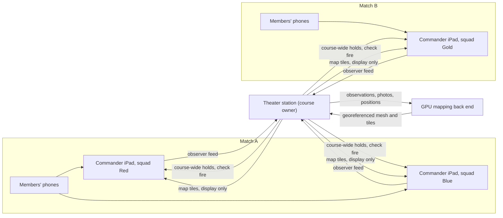
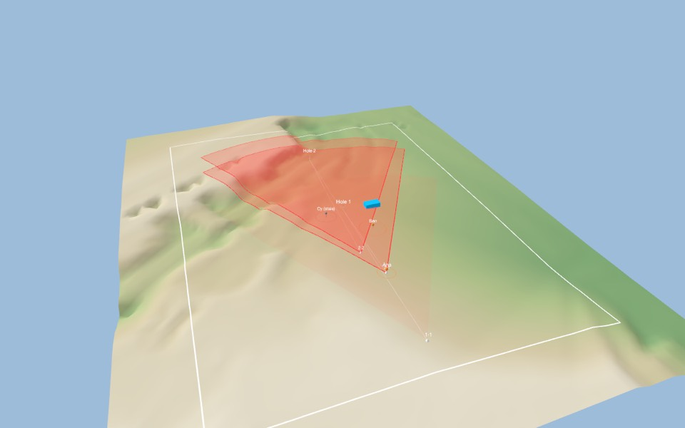

# v4 Theater Mode: the course owner's view

Status: design, not built. **v4 Theater Mode** is the fourth SpudGunGolf version, after v1 Classic, v2 Fire Missions and [v3 Squadz](GROUP_PLAY.md). It builds on v3. Squads still play v2 fire missions, run from each squad's commander iPad. v4 adds a station for the **course owner**: it observes every input on the course and uses a GPU mapping back end to build the field map and a live picture of everything happening on the course.

Read [GROUP_PLAY.md](GROUP_PLAY.md) first. v4 adds no new game rules; it adds an observer, plus a better map for everyone.

## What it is

| | v3 Squadz | v4 Theater Mode |
| --- | --- | --- |
| Who uses it | Squads: a commander's iPad and members' phones | The course owner, at a Theater station, alongside any number of v3 matches |
| Sees | One squad's members and observations; its match's scoreboard | **Every** match and squad on the course: positions, locks, spots, observations, phases, holds and scores |
| Map | Built on the commander's iPad, with an optional Mac render host | Built by the course's **GPU mapping back end**, and shared back to every commander as display |
| Firing | The commander's iPad shows the data and runs SafetyKit | **Observe only.** Theater never shows, computes or clears firing data |
| Can stop play | Check fire from any device; field-wide holds from the match host | Yes: course-wide holds and check fire. Holds only add |

The Theater station is a new app target for a Mac, or an iPad pointed at the same service. It runs on the course's local network with no internet, like the rest of the game.

## How it connects

- **Observer feed.** On a Theater course, each commander's iPad and match host also streams to the Theater station what it already handles: member positions, raw locks, spot reports, observations and capture bundles, `HolePlay` summaries, holds and scores. It uses the same `GroupTransport` and Bonjour service, in a `theater` role, joined with the course's own code. **No firing data is in the feed**, because in v3 firing data never leaves the commander's iPad.
- **Mapping back end.** An external GPU mapping service (a photogrammetry and site-map back end) on the course's local network. The Theater station is its only client.
- **Shared map.** The Theater station sends the finished tiles to every commander's iPad, where they become the map's mesh layer. They are display only, as in v3.

### The mapping interface

The back end sits behind one narrow, versioned interface, `FieldMappingService`, so the game never depends on a particular engine.

| Direction | Contents |
| --- | --- |
| **In** | The course file (boundary, firing points, and flags with pole heights, used as control points). Observations: raw `ReticleLock`s with GPS, bearing and tilt; spots with vantage; position tracks; capture bundles (full-resolution stills with intrinsics and pose; ARKit scene meshes from LiDAR phones) |
| **Out** | A georeferenced mesh or tile set (USDZ or similar, with levels of detail) in the course frame, its transform, and its residuals at each flag; optionally a heightmap and an orthophoto for the 2D view |
| **Not in, not out** | Firing solutions, launcher profiles, downrange confirmations, `Cleared` values. The interface has no fields for them |

The adapter for a given back end lives on the Theater station. Nothing in SpudCore or on the phones knows which engine is behind it.

### v3's Mac render host

v4 **extends** it rather than replacing it. v3's optional Mac render host becomes the small, built-in implementation of the same `FieldMappingService` interface. A backyard match with no course owner keeps using it, or plays without it. On a Theater course, the course's GPU back end takes that role for every match at once, and commanders take their mesh layer from the Theater station instead of a local Mac. Commanders see the same layer, the same safety rule and the same fallback: if the back end goes away, the map falls back to the sparse surface.

## Situational awareness

The Theater station shows the whole course at once:

- **Field.** The course map with the back end's mesh, boundary, hazards, every flag, and every active firing point's safety fan.
- **People.** Every member of every squad, with role, staleness, and which match and squad they belong to. Members inside any active fan are highlighted.
- **Play.** Each match's turn, each squad's phase (setup, firing, ceased and walking out, finished), rounds as ticks or dots, and scoreboards.
- **Holds.** Every hold in force on the course, and who raised it.
- **Coverage.** Where the mesh is thin, so the owner can ask squads to capture there.
- **Replay.** After the day, every match replayed from the feed.

### The 3D view (built)

SpudTheater's toolbar switches between the 2D site map and a 3D view of the course (SceneKit, macOS 14). The ground is a USGS 3DEP bare-earth grid (public domain, US only), sampled every 2.5 m over the boundary plus 20 m (coarser on big courses, at most 12,000 samples) and cached in `~/Library/Application Support/SpudTheater/Fields/<course>/elevation.json`, so each course is fetched once. Outside the US there is no data: the view says so and draws flat ground. On it: the boundary, each hole's pole at its real height with an orange top band and its in-radius ring, the firing points, every safety fan (SafetyKit's ± half-angle to its fan radius, the hole in play strong), each member at their GPS (grey when stale), and any field meshes saved for the course (`FieldStore`), with a toggle. Height can be exaggerated 2×. Drag to orbit, right- or shift-drag to pan, scroll or pinch to zoom; "Reset view" goes back over the whole course.

Scene axes: x east, y up, z south, metres from the grid's frame origin (FieldKit `SceneAxes`). Field meshes are placed by `FieldMeshInfo.toENU` and then ENU → scene; nothing else swaps axes. The geometry (terrain mesh, draping, fans, the axes) is in FieldKit and unit-tested.

## Safety

v3's rules all stand. SafetyKit stays authoritative on each squad's commander iPad.

1. **Theater is observe-only for firing.** It has no code path that shows, computes or clears a solution, and the feed contains none. It can't confirm downrange for any squad, grant a turn or lift a squad's own holds.
2. **The owner gets course-wide holds and check fire.** It is safe because holds only add: a hold from Theater can turn a commander's allowed verdict into blocked, never the reverse.

   | Hold | When |
   | --- | --- |
   | `courseCheckFire(owner)` | The owner calls check fire: every match on the course stops |
   | `courseClosed` | The owner closes the course or a part of it (weather, visitors, maintenance) |
   | `fanConflict(matchA, matchB)` | Two matches' active fans overlap. Theater is the one device that sees both, so it holds the later one |
   | `personInFan` | Anyone tracked by Theater, including the owner's own phone, is inside an active fan |

3. **Lifting.** Owner holds lift only from the Theater station. A course check fire also revokes every squad's downrange confirmation for the current hole, so each commander confirms again before firing, as in v3.
4. **Fail closed.** If a squad's commander loses the Theater link on a course that requires Theater, that squad holds (`theaterLost`). The owner sets this per course; a course can also run Theater as optional, observe-only, with no holds tied to its link.
5. **The map is a picture, not an input.** The back end's mesh, heightmap and positions never feed `clearRange` or `clearSolution`. Ranges come only from cleared locks.
6. **Privacy.** Joining a squad on a Theater course shows that the course owner sees members' positions and captures during play. The course file declares it, and phones show it before they share anything.

## Milestone plan

The v4 build steps are numbered T1–T6. They are separate from v3's G1–G8 and from the app's milestones 1–8, and they need v3 through G6 (the match).

| Step | Builds | Done when |
| --- | --- | --- |
| **T1. Observer feed** | The `theater` role in GroupKit; commanders and match hosts stream positions, locks, spots, observations, phases, holds and scores; a test that no firing data can enter the feed | `swift test` runs two simulated matches into a simulated Theater station, and the feed carries no solution |
| **T2. Theater station, 2D** | A Mac (or iPad) app target: the whole-course map from the course file, every member, every fan, holds and scoreboards | The owner watches two practice matches live on one screen |
| **T3. Course holds** | `courseCheckFire`, `courseClosed`, `personInFan`, `fanConflict`, `theaterLost` in `GroupGate`; the lifting rules; the course file's Theater setting and privacy notice | A course check fire stops both matches; two overlapping fans hold the later match; holds never unlock (property test) |
| **T4. Mapping interface** | `FieldMappingService` with the v3 Mac render host as its first implementation; the georeferencing check against flag residuals | v3's render host runs behind the interface with no change in behaviour |
| **T5. GPU back end adapter** | An adapter from the Theater station to the course's external GPU mapping service; tiles shared to commanders | A captured course renders on the Theater station and on every commander's iPad; the back end going away falls back cleanly |
| **T6. Coverage and replay** | Thin-mesh coverage view, capture requests to squads, replay of a day's matches | The owner can replay a match and see where captures are missing |

For T4 and T5, `spud-mesh` already builds a georeferenced mesh from a folder of photos on the Mac host, with Object Capture; see [MESHING.md](MESHING.md) for shooting the photos and running it.

## Open questions

1. **Station hardware.** Is the Theater station a Mac app, an iPad app, or a web view served by the back end's host? The interface allows any of them; T2 picks one.
2. **The course server.** Should the Theater station also serve `course.yaml` (milestone 8's course server), so a Theater course needs only one box?
3. **How much the owner sees.** Squads' scores and positions, yes. What about each squad's spot reports during play, before a hole finishes?
4. **Fan conflicts.** When should one match hold for another with only a partial overlap? This needs the course's real fan geometry.
